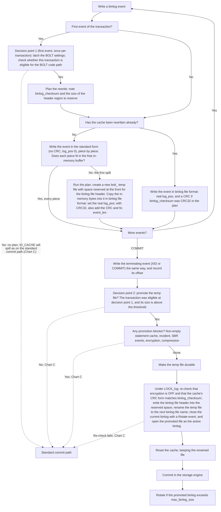
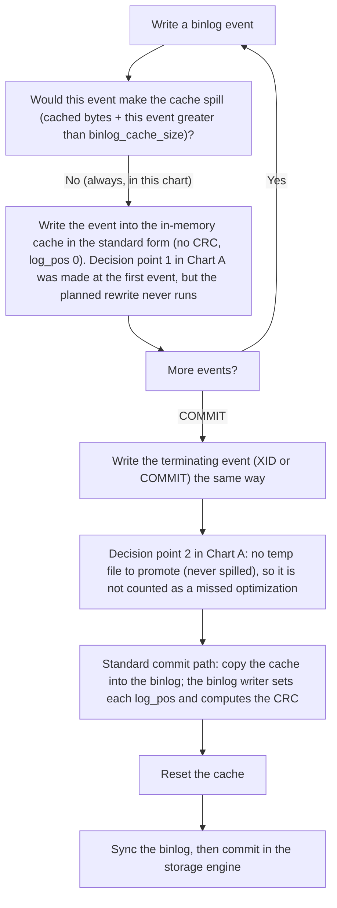
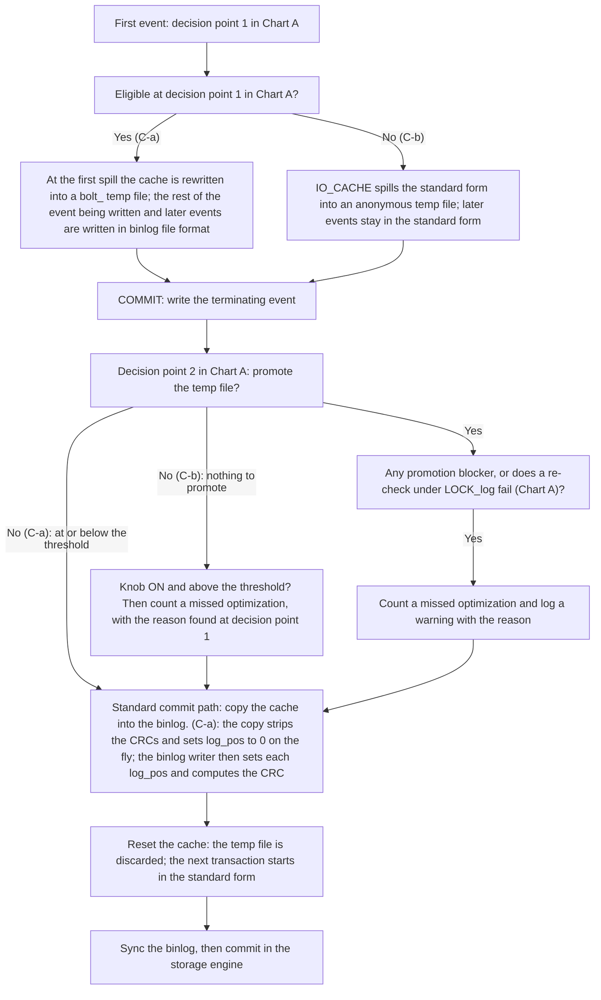
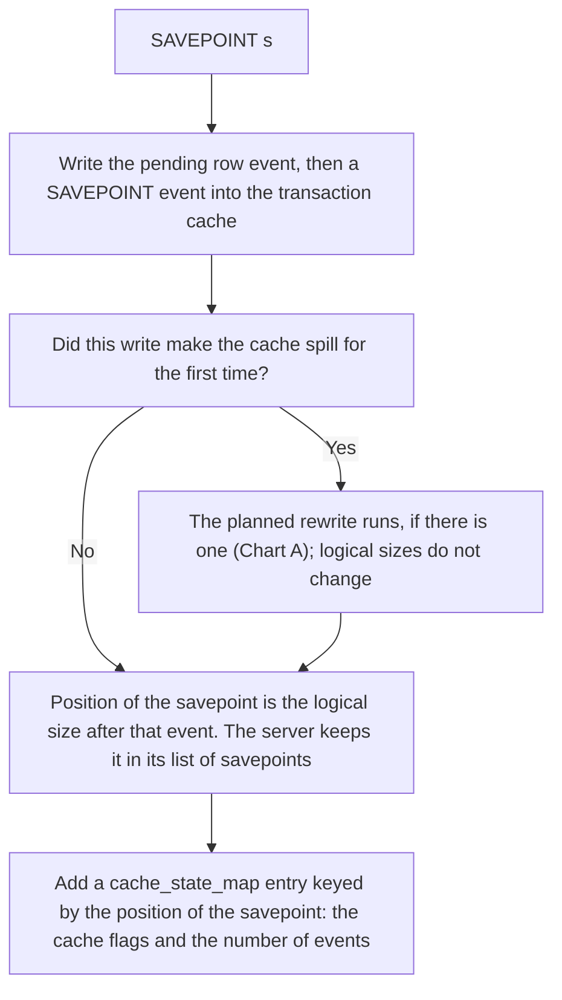
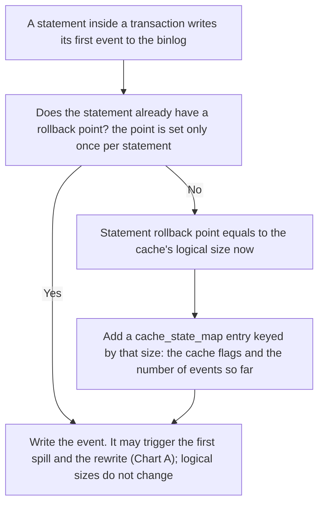
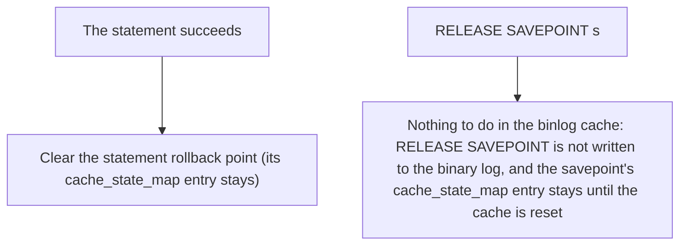
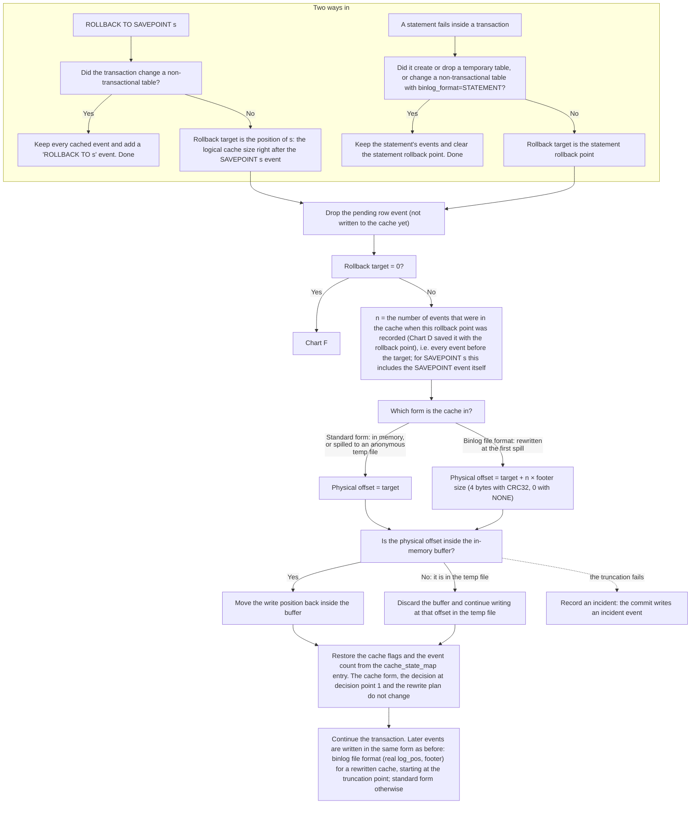
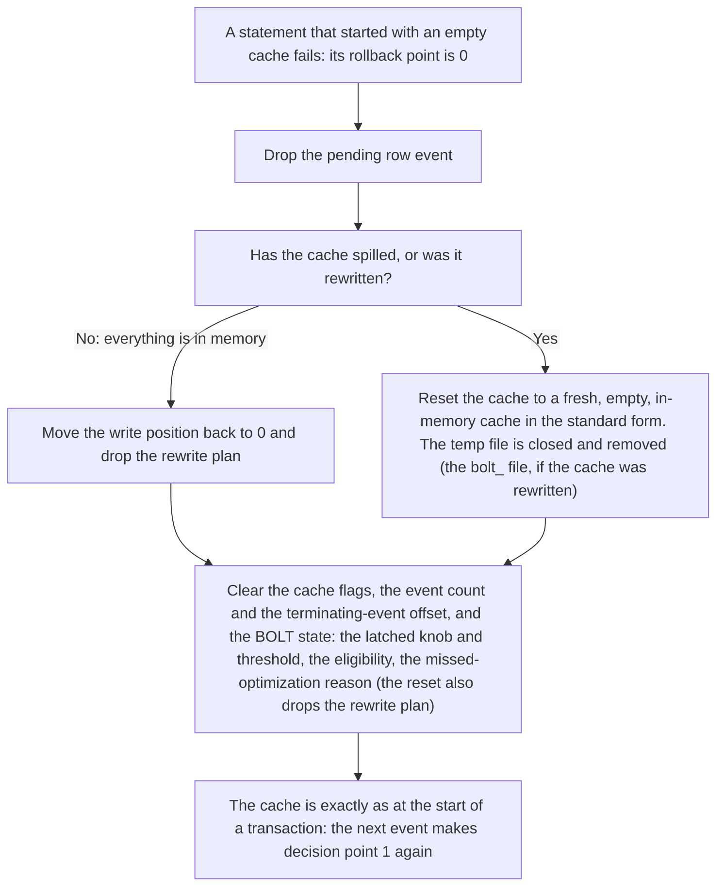

# BOLT: Checksumless Binlog Cache - Design

> This document is temporarily a separate file; it will be merged into the low-level design (low-level-design.md).

## 1. Checksumless cache

BOLT commits a large transaction by promoting its spill file into a binlog file (a rename into the binlog sequence), so commit does constant work. That only works if the spill file already holds the events exactly as they must appear in a binlog file, referred to as binlog file format in this section:

- a CRC32 footer on every event when `binlog_checksum=CRC32`;
- `event_len` including that footer;
- `log_pos` set to the event's real end offset in the future binlog file.

Writing the binlog file format into the cache from the first event would change the cache behaviour for every transaction, not only for the large ones that take the BOLT code path:

- every transaction would compute a CRC when it writes to the cache, and the majority that never take the BOLT code path would compute it again when the cache is copied into the binlog, because the copy changes `log_pos`;
- every reader of the cache would receive checksummed events instead of the un-checksummed bytes it receives today: the standard binlog copy, compression, and Group Replication.

The checksumless cache keeps the existing behaviour for every transaction and keeps the gain for large ones. The cache holds events exactly as the standard commit path caches them (no footer, `event_len` without one, `log_pos = 0`), referred to as standard form in this section. Only when a transaction that is eligible for BOLT spills for the first time is its cache rewritten into the binlog file format, referred to as rewrite in this section; every reader of the cache still sees the standard form. Sections 2 and 3 describe how, and section 4 compares the checksum work.

## 2. High-level design

### 2.1 Binlog cache structure

The checksumless cache adds one layer inside the binlog cache structure:

```
binlog_cache_data                            (sql/binlog/cache_data.h)
  └─ Binlog_cache_storage                    (sql/binlog_ostream.h)
       └─ Binlog_cache_representation        (sql/binlog/cache_representation.h)  ← new
            └─ IO_CACHE_binlog_cache_storage (sql/binlog_ostream.h)
                 └─ IO_CACHE                 (mysys)
```

- `binlog_cache_data` is a session's transaction cache (or statement cache) as the binlog sees it: a sequence of events. It adds events, rolls back to savepoints, and finalizes the transaction at commit. BOLT keeps its per-transaction decisions here.
- `Binlog_cache_storage` is the cache seen as plain bytes. The rest of the server, including Group Replication, reads and writes the cache through it.
- `Binlog_cache_representation` decides how those bytes are stored: in the standard form, or, after the rewrite, in the binlog file format.
- `IO_CACHE_binlog_cache_storage` manages the bytes in memory and in the temporary file: encryption of the file, naming and preparing a `bolt_` file for promotion, and telling whether a write would make the cache spill for the first time, which is where the planned rewrite runs.
- `IO_CACHE` is the generic buffered file of mysys: it keeps up to `binlog_cache_size` bytes in memory and writes the rest to a temporary file.

The two ways of storing the bytes:

| | Standard form (initial) | Binlog file format (after the rewrite) |
| --- | --- | --- |
| Stored events | as the standard commit path caches them | as they will appear in the promoted binlog file |
| Read by the rest of the server | as stored | translated back to the standard form |
| Positions seen by the rest of the server | the stored positions | positions as if there were no checksums |

`Binlog_cache_representation` is the gate between the cache's consumers and its stored bytes: everything above it (the standard binlog copy, compression, Group Replication, savepoints and every SQL-visible size) reads and measures the cache in the standard form, whatever form is stored underneath.

### 2.2 How a large transaction's bytes change form

1. At the transaction's first event, BOLT evaluates, once per transaction, whether the transaction is eligible for the BOLT code path. If it is, BOLT notes `binlog_checksum` and the size of the header region to reserve, for the rewrite.
2. The transaction writes its events into the cache in the standard form, in memory.
3. The cache keeps filling its in-memory buffer until it reaches `binlog_cache_size`.
4. When the next write does not fit in the buffer, BOLT starts the rewrite: instead of spilling the standard form into a temporary file, it converts the bytes in memory into the binlog file format and writes them into a new `bolt_` temp file, with space reserved at the front for the binary log header events.
5. Every later event is written directly in the binlog file format.
6. At commit, the temp file is promoted: its header region is filled in and it is renamed into the binary log sequence. It is already in its final form, so nothing is rewritten at commit.

A small transaction never fills its buffer, so it is never rewritten: it stays in memory in the standard form and is copied into the binary log exactly as without BOLT. A transaction that is not eligible for the BOLT code path is never rewritten either: if it spills, its cache spills in the standard form, as without BOLT.

### 2.3 Falling back to the standard commit path after the rewrite

A rewritten transaction that is not promoted (at or below the threshold, or a blocker applies at commit) commits through the standard commit path. The cache is read back in the standard form: as the bytes are copied, each footer is dropped, `event_len` is reduced by it and `log_pos` is set to 0. The binary log writer then sets each event's end position in the active binary log file and adds the checksum if `binlog_checksum` requires it, as for any other transaction.

### 2.4 Rolling back after the rewrite

Rollback points (savepoints and the implicit rollback point of each statement) are logical positions: the size of the cache in the standard form when the rollback point was recorded. When a rollback point is recorded, the number of events in the cache at that moment is recorded with it.

1. Rolling back to a savepoint, or a statement's own rollback: every event in a rewritten cache carries exactly one footer, so the physical position of the rollback point is the logical position plus one footer (4 bytes with CRC32, 0 with NONE) for each event before it. The event count recorded with the rollback point gives that number, so nothing is scanned. The position counts from the start of the stored events, after the reserved header region.
2. Any other truncation target: the cache is scanned from the start, event header by event header, to find the stored position. No current caller needs this; it is kept as a fallback.
3. Rolling back to position 0 (the first statement fails): the cache is reset to a fresh, empty cache in the standard form, and the transaction's BOLT state is cleared.

## 3. Low-level design

This section describes the code paths of the checksumless cache: how a transaction's cache is written, rewritten, committed, and rolled back, for a large transaction that is promoted (3.1), a small one (3.2), a large one that is not promoted (3.3), and rollback points (3.4 to 3.6).

Each subsection below gives a flowchart first, then the code paths for its key steps. (new) marks code added by this design; (changed) marks existing code it modifies. A dashed arrow in a chart marks an exit that another chart covers.

Terms used in the charts:

- Rewrite: storing the events in binlog file format instead of the standard form. Rewriting an event sets its real `log_pos` and, with `binlog_checksum=CRC32`, appends a CRC footer and adds 4 to `event_len` (with `NONE`, only `log_pos` changes). A cache stored this way is a rewritten cache.
- Standard form: no footer, `event_len` without one, `log_pos = 0`.
- Decision point 1: at the transaction's first event, BOLT decides, once per transaction, whether the transaction is eligible for the BOLT code path, and if so plans the rewrite. The answer holds for the rest of the transaction (except after a rollback to position 0, Chart F).
- First spill: the first write into the cache that does not fit in the free in-memory buffer. An event is written in several pieces (header, body parts), so this is usually in the middle of an event. The planned rewrite runs here.
- Decision point 2: at commit, BOLT decides whether to promote the transaction's temp file. Only the temp file of a transaction that was eligible at decision point 1 can be promoted.

### 3.1 Large transaction, temp file promoted



#### Code paths

1. Opening the cache: `Binlog_cache_storage::open()` (changed) creates the standard-form representation (`create_checksumless_cache_representation()`, new). It has no reserved header region and an anonymous spill file, so a cache that is never rewritten stores exactly what it stores without BOLT.
2. The first event: `binlog_cache_data::write_event()` (changed) calls `latch_large_trx_optimization()` (new), which evaluates eligibility and, for an eligible transaction, passes `binlog_checksum` and the reserved header size to `Binlog_cache_storage::plan_large_trx_rewrite()` (new).
3. Events that fit in memory: serialized in the standard form into the IO_CACHE buffer. `Binlog_cache_storage::write()` (changed) checks each write with `write_would_spill()` (new).
4. The first spill: `Binlog_cache_storage::write()` calls `rewrite_into_binlog_file_format()` (new), which creates the binlog-file-format representation (`Checksummed_binlog_cache_representation::create_from_standard_format()`, new): it opens a named file with the reserved header region at the front, copies the in-memory bytes into it through `Event_format_converter` (new), and replaces the standard-form representation. The converter rewrites each event's header (real `log_pos`, `event_len` + 4) and appends the CRC32 footer; it keeps its state between writes, so the rest of the interrupted event goes through it too.
5. Later events: `write_event()` sets `log_pos` and `checksum_alg` before serializing, and the existing event serializer writes the CRC. `add_logical_length()` (new) keeps the logical length up to date.
6. Commit: `finalize()` writes the terminating event and records its offset. `get_cache_for_large_trx_commit()` checks that the transaction is a promotion candidate with no blocker. `MYSQL_BIN_LOG::commit_large_transaction()` makes the file durable (`flush_and_sync_spilled_file()`), and `promote_spilled_file()`, under `LOCK_log`, re-checks encryption and the checksum algorithm (`physical_checksum_alg()`), writes the binary log header events into the reserved region, and renames the file into the binary log sequence.
7. Reset: `Binlog_cache_storage::reset()` (changed) keeps the promoted file, drops the rewrite plan, and replaces the representation with a new standard-form one.

### 3.2 Small transaction, never spilled



### 3.3 Large transaction, spilled, temp file not promoted

A large transaction can reach the standard commit path in two ways:

- (C-a) Eligible at decision point 1 in Chart A, temp file not promoted at decision point 2 in Chart A. At its first event the transaction was eligible, so at the first spill its cache was rewritten into a `bolt_` temp file in binlog file format. At commit its temp file is not promoted: the transaction's size is at or below the threshold, or a blocker applies (for example SBR events written after the first event).
- (C-b) Not eligible at decision point 1 in Chart A. At its first event the transaction was not eligible (for example the knob is OFF, or encryption or compression is ON), so there was no plan and its cache was not rewritten. IO_CACHE spilled the standard form into an anonymous temp file, as on the standard commit path. A planned rewrite that fails also ends here: the cache stays in the standard form and spills as without the optimization, and no statement fails. It counts as a missed optimization if the transaction ends above the threshold.



In (C-b), the temp file holds the standard form, so it cannot be promoted. Whether the transaction counts as a missed optimization depends on why it was not eligible at decision point 1:

- The knob was OFF: not counted. BOLT was not in use for this transaction.
- The knob was ON, but another condition failed at the first event (for example the first event was in statement format, or encryption or compression was ON): counted if the transaction ends above the threshold, with that condition as the reason in the warning.

#### Code paths

- `Binlog_cache_storage::copy_to()` (changed) → `Checksummed_binlog_cache_representation::copy_logical_to()` (new): copies through `Event_format_converter` in the `kToStandardFormat` direction, which drops each footer, subtracts it from `event_len` and sets `log_pos` to 0.

### 3.4 Recording a rollback point

The savepoint charts (D, E, F) cover only how rollback points are recorded and how the cache is truncated. What happens at commit afterwards is the same as without savepoints (Charts A to C), so it is not repeated. They apply to every cache state: small (in memory), spilled in the standard form, and rewritten at the first spill.

There are two kinds of rollback points:

- `SAVEPOINT s` (explicit). Created by the user; it lasts until the transaction ends or a rollback goes past it.
- The statement rollback point (implicit). Inside a transaction, a statement that fails is rolled back on its own: the transaction stays open and the earlier statements keep their changes. The engine does this with its own statement savepoint, and the binlog cache must match it by dropping only the failed statement's events. So when a statement writes its first event, the server records where the statement starts in the cache (`before_stmt_pos`). No `SAVEPOINT` event is written for it.

Both kinds are recorded the same way (below) and rolled back the same way (Chart E). A statement rollback point of 0, when a statement that started with an empty cache fails, is the special case in Chart F.

A rollback point is a logical position: the number of bytes the events take without checksum footers. The rewrite adds footers to the stored bytes but does not change this number, so a rollback point recorded before the rewrite still marks the same event boundary after it. When a rollback point is recorded, the cache also adds an entry to `cache_state_map`, keyed by the rollback point's logical position: the cache flags and the number of events in the cache at that moment, which is the number of events before the rollback point. Chart E uses that count to find the physical offset, and restores the flags from the entry.

**SAVEPOINT s (explicit)**



**Statement rollback point (implicit)**



**End of a statement, RELEASE SAVEPOINT**



#### Code paths

- `SAVEPOINT` and statement start record the point through `binlog_cache_data::cache_state_checkpoint(pos)` (existing), which stores the flags and `event_counter` in `cache_state_map`, keyed by `pos`. Nothing new is stored.
- `pos` comes from `get_byte_position()` → `Binlog_cache_storage::length()` (changed), which returns the logical length.

### 3.5 Rolling back to a rollback point (truncation and position calculation)

This subsection covers how the physical offset is found, for a cache rewritten with CRC32 (each event gets a 4-byte footer). Offsets count from the start of the cached data, after the reserved header region:

| Event | Logical length | Logical end | Physical length | Physical end |
| --- | --- | --- | --- | --- |
| E1 (BEGIN) | 100 | 100 | 104 | 104 |
| E2 (Table_map) | 50 | 150 | 54 | 158 |
| E3 (SAVEPOINT s) | 60 | 210 (position of s; 3 events before it) | 64 | 222 |
| E4 (Write_rows, triggers the first spill and the rewrite) | 300 | 510 | 304 | 526 |
| E5 (Write_rows) | 300 | 810 | 304 | 830 |

`ROLLBACK TO s`: physical offset = 210 + 3 × 4 = 222, the end of E3: the rewrite added one to each event written before it, including those written before the savepoint. With `binlog_checksum=NONE` the footer size is 0, so physical equals to logical.



#### Code paths

- `binlog_cache_data::truncate(pos)` (changed) looks up `event_counter` for `pos` in `cache_state_map` and calls `Binlog_cache_storage::truncate_at_event_boundary(pos, n)` (new), which truncates at `pos + n × footer size`. A target with no entry in the map uses the scanning `truncate()`. A failed truncation records an incident.
- `binlog_cache_data::cache_state_rollback(pos)` (existing) restores the flags and the event count.

### 3.6 Rollback to position 0 (a failing statement that started with an empty cache)

A statement's rollback point is 0 when the transaction cache was empty as the statement started. It is either the first statement in the transaction that writes to the binlog, or every earlier statement's events were rolled back. When such a statement fails, the whole cache is rolled back. After that the cache must be exactly as at the start of a transaction, because the transaction can end with this empty cache, and an empty cache is never reset at commit or rollback. Otherwise the next transaction would inherit this one's rewrite plan, latched values and `bolt_` file.



#### Code paths

- `binlog_cache_data::truncate(0)` (changed): if the cache spilled or was rewritten, `Binlog_cache_storage::reset()` returns it to a fresh standard-form cache and drops the rewrite plan; otherwise it truncates to 0 in memory and calls `clear_large_trx_rewrite_plan()` (new).
- `binlog_cache_data::cache_state_rollback(0)` (changed) clears the BOLT state, so the next event calls `latch_large_trx_optimization()` again.

## 4. Checksum cost (knob ON, `binlog_checksum=CRC32`)

| Transaction | CRC work while writing the cache | CRC work at commit |
| --- | --- | --- |
| Never spills | none | once per event, during the binlog copy (existing behaviour) |
| Spills, not eligible at the first event | none | once per event, during the binlog copy (existing behaviour) |
| Spills, rewritten, temp file promoted | once per event: during the rewrite for the events | none |
| Spills, rewritten, temp file not promoted (at or below the threshold, or a fallback) | once per event: during the rewrite for the events | once per event again: during the binlog copy, strips the footers and the binlog writer recomputes them |
| Knob OFF | existing behaviour | existing behaviour |
