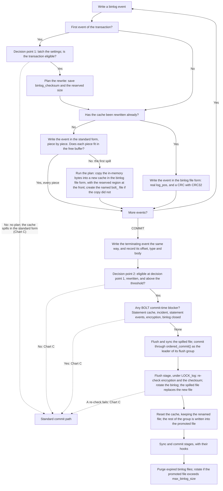
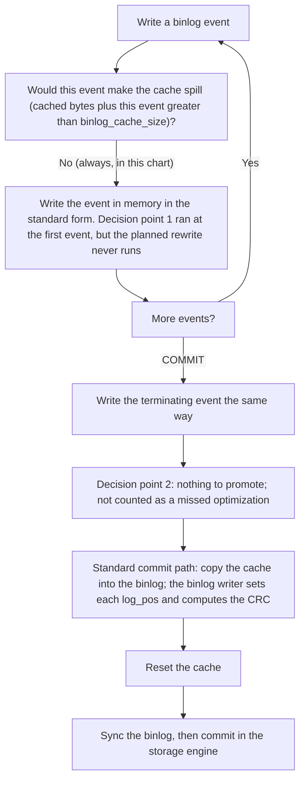
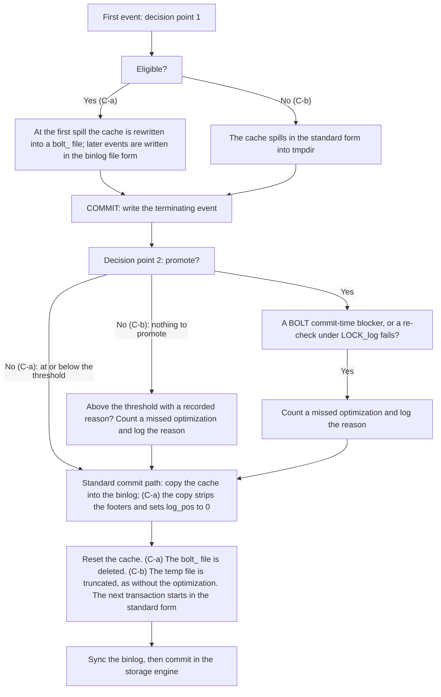
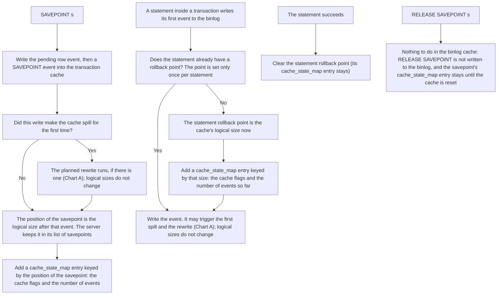
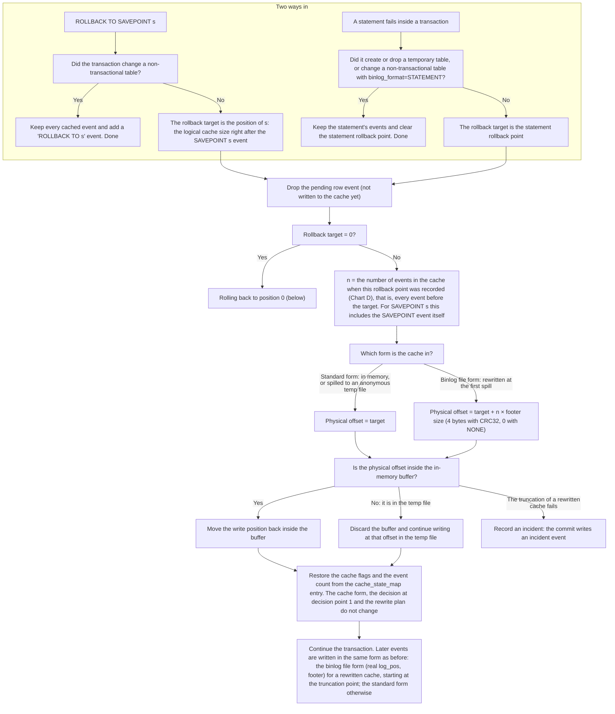

# Low-Level Design

The high-level design describes what the binlog large transaction optimization (BOLT) does and why. This document expands it into the implementation. It describes the classes, functions and code paths that carry out each part of the design, and how each failure is handled.

The sections follow a large transaction through the server. They start with an overview, then describe how the transaction's events are written and committed, then cover what happens when something goes wrong, and end with recovery, configuration and compatibility.

Table of contents:

1. Overview
2. The binlog cache
3. Committing a large transaction through `ordered_commit()`
4. The `File_rotation` interface
5. Fallbacks and error handling
6. Recovery
7. Configuration and observability
8. Feature compatibility
9. Appendix: source files

## Glossary

- **Standard form.** The form in which the standard commit path caches events. An event in the standard form has no checksum footer, its `event_len` does not count a footer, and its `log_pos` is 0. A standard-form cache stores every event in the standard form. The code calls such a cache checksumless (`Checksumless_binlog_cache_representation`).
- **Binlog file form.** The form in which events appear in a binlog file. An event in the binlog file form has its real `log_pos`. With `binlog_checksum=CRC32`, it also has a 4-byte CRC32 footer, which `event_len` counts. A binlog-file-form cache stores every event in the binlog file form. The code calls such a cache checksummed (`Checksummed_binlog_cache_representation`), regardless of the value of `binlog_checksum`.
- **Rewrite.** The conversion of a cache from the standard form into the binlog file form, at the cache's first spill.
- **Active file.** The binlog file in use before the rotation.
- **New file.** The next file in the binlog sequence, which the rotation creates and the promoted spilled file replaces.

## 1. Overview

A large transaction goes through the same steps as any other transaction. It writes its events into the binlog cache, commits through the binlog group commit, and is read again by crash recovery and GTID reconstruction after a restart. BOLT keeps every step and changes three of them:
   - When the cache spills to a temp file for the first time, the cache is rewritten into the binlog file form, in a spill binlog file that can become a binlog file (section 2).
   - In the flush stage, the spill binlog file is promoted into a binlog file instead of being copied to the active binlog file (sections 3 and 4).
   - In recovery, the body of the large transaction is skipped instead of being read sequentially (section 6).

When a step cannot use the optimization, the transaction falls back to the standard commit path (section 5). Section 7 covers configuration and the log messages, and section 8 covers compatibility with other features.

## 2. The binlog cache

The first change is in the binlog cache. The cache of every transaction starts in the standard form, which has no checksums. Only the cache of a transaction that may go through the BOLT code path is rewritten into the binlog file form, when the cache spills for the first time. Such a transaction is called BOLT-eligible, or eligible for short. The eligibility decision is made once, at the transaction's first event. This section explains when the cache is rewritten, how the cache is built, how the rewrite happens and where the spill binlog file is kept, and how a rewritten cache is read back, limited in size and rolled back.

### 2.1 When the cache is rewritten

BOLT commits a large transaction by promoting its spilled file into a binlog file, so the commit does constant work. That works only if the spilled file already holds the events in the binlog file form.

Most transactions are never promoted, so their caches do not need the binlog file form. Writing every event in the binlog file form from the first event, with its checksum, would have two costs for every transaction, not only for the large ones:

- every transaction would compute a CRC when it writes to the cache, and the many that are not promoted would compute it again when the cache is copied into the binlog, because the copy changes `log_pos`;
- every reader of the cache would receive checksummed events instead of the standard form it receives today: the standard binlog copy, compression and Group Replication.

So the cache stays in the standard form until the cache needs to spill to a file. Only when an eligible transaction spills for the first time is its cache rewritten into the binlog file form. Every reader of the cache still sees the standard form.

### 2.2 Binlog cache structure

BOLT adds one layer inside the binlog cache:

```
binlog_cache_data                            (sql/binlog/cache_data.h)
  └─ Binlog_cache_storage                    (sql/binlog_ostream.h)
       └─ Binlog_cache_representation        (sql/binlog/cache_representation.h)  ← new
            └─ IO_CACHE_binlog_cache_storage (sql/binlog_ostream.h)
                 └─ IO_CACHE                 (mysys)
```

- `binlog_cache_data` is a session's transaction cache or statement cache as the binlog sees it, a sequence of events. It adds events, rolls back to savepoints, and finalizes the transaction at commit. BOLT keeps its per-transaction decisions here.
- `Binlog_cache_storage` is the cache seen as plain bytes. The rest of the server, including Group Replication, reads and writes the cache through it.
- `Binlog_cache_representation` decides how those bytes are stored: in the standard form (`Checksumless_binlog_cache_representation`), or, after the rewrite, in the binlog file form (`Checksummed_binlog_cache_representation`).
- `IO_CACHE_binlog_cache_storage` manages the bytes in memory and in the temporary file: encryption of the file, the named `bolt_` file, the reserved region, and whether a write would make the cache spill for the first time, which is where the planned rewrite runs.
- `IO_CACHE` is the generic buffered file of mysys. It keeps up to `binlog_cache_size` bytes in memory and writes the rest to a temporary file.

The two ways of storing the bytes:

| | Standard form (initial) | Binlog file form (after the rewrite) |
| --- | --- | --- |
| Stored events | as the standard commit path caches them | as they appear in the promoted binlog file |
| Read by the rest of the server | as stored | translated back to the standard form |
| Positions seen by the rest of the server | the stored positions | positions as if there were no footers |

`Binlog_cache_representation` is the gate between the cache's consumers and its stored bytes. Everything above it reads and measures the cache in the standard form, regardless of the form stored underneath. That includes the standard binlog copy, compression, Group Replication, savepoints and every size that SQL can see.

### 2.3 How a large transaction's bytes change form

1. At the transaction's first event, `latch_large_trx_optimization()` decides once whether the transaction is eligible (decision point 1). It captures the optimization's setting and threshold. The transaction is eligible when the optimization is ON and `large_trx_latch_blocker()` finds no blocker:
   - no incident is pending;
   - the first event is not in statement format, and the statement that writes it is logged in row format (the first event of a DML transaction is its BEGIN, which is never in statement format);
   - binlog encryption is OFF;
   - binlog transaction compression is OFF.
   
   For an eligible transaction, it plans the rewrite with `plan_large_trx_rewrite()`: it saves `binlog_checksum` and the reserved size for the rewrite.
2. The transaction writes its events in the standard form, in memory. The cache keeps filling its in-memory buffer until it reaches `binlog_cache_size`.
3. When a write would not fit in the memory buffer (`write_would_spill()`), the planned rewrite runs instead of the standard spill (`rewrite_into_binlog_file_format()`). The rewrite creates a new cache in the binlog file form, with its own memory buffer, and copies the bytes of the old cache's buffer into it, converting each event into the binlog file form. The new cache's spill file is a named `bolt_` file, with space reserved at the front for the binlog header events. The footers make the converted bytes larger, so the copy itself can fill the new buffer and spill into the `bolt_` file. The new cache then replaces the old one, and the write continues in the new cache.
4. Every later event is written in the binlog file form directly.
5. At commit, the spilled file is promoted. Its header region is filled in, and the file is renamed into the binlog sequence. It is already in its final form, so nothing is rewritten at commit.

A small transaction never fills its buffer, so it is never rewritten. It stays in memory in the standard form and is copied into the binlog exactly as without the optimization. A transaction that is not eligible is never rewritten either: if it spills, it spills in the standard form into `tmpdir`.

The rewrite runs under `Rewrite_error_handler`, which handles a failure of the rewrite in one of two ways. Section 5.3 lists both cases, in rows 3 and 4.

- A non-fatal error, for example a spill file that cannot be created in a full directory, keeps the cache in the standard form, and the write spills as without the optimization. The statement shows no error or warning. The server logs `ER_BINLOG_BOLT_REWRITE_FAILED` with the first error message. At commit, a transaction above the threshold is counted as a missed optimization with `kRewriteFailed`.
- A fatal error, for example running out of memory, is not hidden, and the statement fails with it.

### 2.4 Binlog temp files directory

A cache that is rewritten into the binlog file form spills into a named file in `<binlog directory>/#binlog_temp_files/<binlog base name>`. Servers that share a binlog directory have different base names, so each server creates and cleans only its own subdirectory. A cache in the standard form spills anonymously into `tmpdir`, as without the optimization.

`Binlog_temp_files_dir` (`binlog_ostream.cc`) manages the directory:

- `init()` runs at startup when the binlog is ON (`mysqld.cc`), regardless of the optimization's setting, because a previous run may have had it ON. It builds the two paths (`m_parent`, `m_path`). It rejects a path that is not a directory or is a symbolic link. It deletes leftover spill files.
- `create()` creates the two directories. It runs at startup when the optimization is ON, and when the optimization is set ON.
- When `init()` or `create()` fails at startup with the optimization ON, the server turns the optimization OFF and logs `ER_BINLOG_BOLT_DISABLED_TEMP_FILES_DIR`. The reason was logged before it. With the optimization OFF, the reason is logged as a warning.
- A value of ON set with `SET PERSIST` is applied later in the startup, through the variable's check function, which calls `create()`. When the directory is unusable, the check fails, and the server does not start (`ER_CANT_SET_UP_PERSISTED_VALUES`), as for any persisted variable that cannot be applied.

Startup cleanup (`temp_files_dir_clear_files()`):

- It deletes only regular files whose names match `bolt_` followed by letters, digits and `_` (`is_bolt_temp_file()`).
- Any other entry, including a symbolic link or an entry whose path is too long, is left in place with `ER_BINLOG_BOLT_TEMP_FILES_DIR_SKIPPED_ENTRY`, which gives the reason.
- A matching file that cannot be deleted is left in place with `ER_BINLOG_BOLT_TEMP_FILES_DIR_UNDELETED_FILE`. It is never reused, because every new spill file gets a unique name.
- It logs `ER_BINLOG_BOLT_TEMP_FILES_DIR_CLEANED` with the number of files it removed.
- No result of the cleanup stops the server startup.

Spill file naming and permissions. A cache rewritten into the binlog file form sets `IO_CACHE::named_file_creator` to `create_binlog_cache_file()`. The IO_CACHE calls it when it creates its temporary file. The function creates `bolt_<server start time hex>_<serial hex>` with `O_CREAT | O_EXCL`. A name that a leftover file already has is skipped, and the next serial is tried. The file gets the permissions of a binlog file, because it may become one. A cache that never sets the creator keeps the anonymous, unlinked file of the standard path, which can never be promoted.

### 2.5 Reserved header region

A rewritten cache places its first event after a region reserved at the front of the spilled file, so the transaction's events start right after the region. The region's size is recorded at the transaction's first event, and it does not change afterwards. The region's content is written at promotion.

The size is the header length of the active binlog file plus a headroom, rounded up to a multiple of `kBinlogTempFileReservedBytes` (64 KiB):

| Component | What it covers | Where the value comes from |
| --- | --- | --- |
| header length: magic number, `Format_description_log_event`, `Previous_gtids_log_event` | the length of these events in the active binlog file | when the file is opened, at server startup or at a rotation, `open_binlog()` writes the header events of the file, then takes the number of bytes the file holds (`m_binlog_file->position()`). For an encrypted binlog file, this number leaves out the encryption header at the front of the file. That is safe, because a promotion falls back when binlog encryption is ON |
| headroom | 32 KiB. It covers the `Large_transaction_header_event` and the `Gtid_log_event`, and growth of the `Previous_gtids_log_event` before the promotion | the constant `kBinlogTempFileHeaderHeadroomBytes` |

At promotion, the region holds, in this order:

| Content | Length in the promoted binlog file |
| --- | --- |
| magic number, `Format_description_log_event`, `Previous_gtids_log_event` of the new file | their real length |
| `Large_transaction_header_event` | the rest of the region, through its padding |
| `Gtid_log_event` | its real length. It ends exactly at the end of the region |

`set_binlog_cache_reserved_bytes()` computes the reserved region size as the header length plus the headroom, rounded up to a multiple of `kBinlogTempFileReservedBytes` (64 KiB). A transaction reads the size at its first event (`get_binlog_cache_reserved_bytes()`). Only the spilled file of a rewritten cache has a reserved region.

At promotion, `large_trx_header_events_fit()` checks that the region is large enough for the new file. The new file's header events can be longer than the ones measured when the size was recorded, because the `Previous_gtids_log_event` grows. The check adds the real length of the new file's header events, the shortest `Large_transaction_header_event` that can hold the longest terminating event body, and the longest possible `Gtid_log_event` with its footer, and compares the sum with the region's size. When the sum is larger, the transaction falls back into the new file with `kReservedHeaderSpace`. `large_trx_header_event_padding()` sizes the padding so that the `Gtid_log_event` ends exactly at the reserved size.

### 2.6 Falling back after the rewrite

A rewritten transaction that is not promoted, because it is at or below the threshold or a BOLT blocker applies at commit, commits through the standard commit path. The cache is read back in the standard form (`copy_logical_to()`, through `Event_format_converter` in the `kToStandardFormat` direction): each footer is dropped, `event_len` is reduced by it, and `log_pos` is set to 0. The binlog writer then sets each event's end position in the active binlog file and adds the checksum if `binlog_checksum` requires it, as for any other transaction. The reserved region is never copied.

### 2.7 The binlog cache size limit

`max_binlog_cache_size` limits the bytes the cache stores, with and without the optimization. A rewritten cache stores each event with its footer, so with CRC32 the footers count against the limit, 4 bytes per event. A transaction of many small events can therefore reach the limit with fewer events with the optimization ON. This also applies when the spilled file is not promoted, because the rewrite happens at the first spill. The reserved region does not count against the limit. With `binlog_checksum=NONE`, a rewritten cache stores the same bytes as a cache in the standard form.

### 2.8 Flowcharts

The flowcharts below show how a transaction's cache is written, rewritten, committed and rolled back. Charts A to C follow a large transaction whose spilled file is promoted, a small transaction that never spills, and a large transaction whose spilled file is not promoted. Charts D and E show how a rollback point is recorded and how the cache is rolled back to it (section 2.9).

Terms used in the charts:

- Rewrite: storing the events in the binlog file form instead of the standard form. Rewriting an event sets its real `log_pos`. With `binlog_checksum=CRC32`, it also appends a CRC footer and adds 4 to `event_len`. With `NONE`, only `log_pos` changes.
- Decision point 1: at the transaction's first event, whether the transaction is eligible. The answer holds for the rest of the transaction, except after a rollback to position 0.
- First spill: the first write that does not fit in the free in-memory buffer. An event is written in several pieces, the header and parts of the body, so this is usually in the middle of an event. The planned rewrite runs here.
- Decision point 2: at commit, whether to promote the spilled file. Only the spilled file of a transaction that was eligible at decision point 1 can be promoted.

Legend:

- (new) marks code that the optimization adds.
- (changed) marks existing code that the optimization modifies.
- (existing) marks existing code that the optimization uses unchanged.
- A dashed arrow marks an exit that another chart covers.

#### Chart A: large transaction, spilled file promoted



Code paths:

1. Opening the cache: `Binlog_cache_storage::open()` (changed) creates the standard-form representation (`create_checksumless_cache_representation()`, new). It has no reserved region, and if the cache spills, it spills into an anonymous file in `tmpdir`. So a cache that is never rewritten stores exactly what it stores without the optimization.
2. The first event: `binlog_cache_data::write_event()` (changed) calls `restore_standard_form()` (new), which does nothing unless a failed reset left the cache in the binlog file form. Then it calls `latch_large_trx_optimization()` (new), which passes `binlog_checksum` and the reserved size to `Binlog_cache_storage::plan_large_trx_rewrite()` (new).
3. Events that fit in memory: serialized in the standard form. `Binlog_cache_storage::write()` (changed) checks each write with `write_would_spill()` (new).
4. The first spill: `Binlog_cache_storage::write()` calls `rewrite_into_binlog_file_format()` (new). `Checksummed_binlog_cache_representation::create_from_standard_format()` (new) opens a cache with the named file creator and the reserved region, copies the in-memory bytes through `Event_format_converter` (new), replaces the standard-form representation, and calls `IO_CACHE_binlog_cache_storage::create_spilled_file()` (new), which creates the file only when the copy has not created it. The converter rewrites each event's header (real `log_pos`, `event_len` plus the footer) and appends the CRC32 footer. The rewrite usually runs in the middle of an event. The converter keeps its state between writes, so the rest of the event that triggered the rewrite also goes through the converter. Later events are written in the binlog file form directly, without the converter (step 5).
5. Later events: `write_event()` sets `log_pos` and the checksum algorithm before serializing, and the existing event serializer writes the CRC. `add_logical_length()` (new) keeps the logical length up to date.
6. Commit: `finalize()` writes the terminating event and records its offset, type and body. `get_cache_for_large_trx_commit()` (new) checks the candidate and the BOLT blockers. `MYSQL_BIN_LOG::commit()` (changed) syncs the spilled file before the `before_commit` hook and marks the cache for promotion after it.
7. Reset: `Binlog_cache_storage::reset()` (changed) keeps a promoted file (`Spilled_file_on_reset::kKeep`), drops the rewrite plan, and replaces the representation with a new standard-form one.

The call chain of the rewrite at the first spill (code paths 3 and 4):

```
binlog_cache_data::write_event()
└─ binary_event_serialize()                                                             # serializes the event into the cache
   └─ Binlog_cache_storage::write()                                                     # the first write that would spill
      └─ Binlog_cache_storage::rewrite_into_binlog_file_format()
         └─ binlog::create_checksummed_cache_representation()
            └─ Checksummed_binlog_cache_representation::create_from_standard_format()
               ├─ Checksumless_binlog_cache_representation::copy_logical_to()
               │  └─ Event_format_converter::write()                                    # converts each event into the binlog file form
               └─ IO_CACHE_binlog_cache_storage::create_spilled_file()
```

#### Chart B: small transaction, never spilled



#### Chart C: large transaction, spilled, file not promoted

A large transaction reaches the standard commit path in two ways:

- (C-a) Eligible at decision point 1, not promoted at decision point 2. The cache was rewritten into a `bolt_` file at the first spill. At commit the transaction's logical size is at or below the threshold, or a BOLT blocker applies, for example statement-format events written after the first event.
- (C-b) Not eligible at decision point 1, for example because the optimization is OFF, or encryption or compression is ON. There was no plan, and the cache was not rewritten. The cache spilled in the standard form into an anonymous file in `tmpdir`, as on the standard commit path. A planned rewrite that fails also ends here. The cache stays in the standard form and spills as without the optimization, and no statement fails.



In (C-b), the spilled file holds the standard form, so it cannot be promoted. Whether the transaction counts as a missed optimization depends on why it was not eligible:

- When the optimization was OFF, the transaction is not counted, because BOLT was not in use for it.
- When the optimization was ON and a BOLT blocker applied at the first event, or the rewrite failed, the transaction is counted when it ends above the threshold, with that reason.

### 2.9 Rollback points

A rollback point is a logical position, which is the number of bytes the events take in the standard form. There are two kinds:

- `SAVEPOINT s` (explicit). It lasts until the transaction ends or a rollback goes past it.
- The statement rollback point (implicit). Inside a transaction, a statement that fails is rolled back on its own. The transaction stays open, and the earlier statements keep their changes. The engine does this with its own statement savepoint, and the binlog cache must match it by dropping only the failed statement's events. So when a statement writes its first event, the server records where the statement starts in the cache (`before_stmt_pos`). No `SAVEPOINT` event is written for it.

When a rollback point is recorded, `binlog_cache_data::cache_state_checkpoint()` (existing) adds an entry to `cache_state_map`. The entry is keyed by the logical position, and holds the cache flags and the number of events in the cache at that moment. The rewrite adds footers, so each event moves to a larger physical offset in the stored bytes. Its logical position, its offset in the standard form, stays the same. So the positions recorded before the rewrite, in `cache_state_map` and in the server's savepoints and `before_stmt_pos`, still mark the same event boundaries after it.

Recording a rollback point works the same way for every cache state, whether the cache is in memory, spilled in the standard form, or rewritten at the first spill. What happens at commit afterwards is the same as without savepoints (charts A to C).

**Chart D: recording a rollback point**



Code paths:

- `SAVEPOINT` and the statement start record the point through `binlog_cache_data::cache_state_checkpoint(pos)` (existing), which stores the flags and `event_counter` in `cache_state_map`, keyed by `pos`. Nothing new is stored.
- `pos` comes from `get_byte_position()` → `Binlog_cache_storage::length()` (changed), which returns the logical length.

#### Rolling back to a rollback point

Every event in a rewritten cache carries exactly one footer. So the physical offset of a rollback point is the logical position plus one footer for each event before it. `binlog_cache_data::truncate()` (changed) looks up the event count in `cache_state_map` and calls `Binlog_cache_storage::truncate_at_event_boundary()` (new). Nothing is scanned. Offsets count from the start of the stored events, after the reserved region. A target with no map entry uses the scanning `truncate()`, which reads the cache from the start, event header by event header, to find the stored position. No current caller needs it, because every truncation target is a rollback point. It is kept as a fallback.

Example, rewritten with CRC32:

| Event | Logical length | Logical end | Physical length | Physical end |
| --- | --- | --- | --- | --- |
| E1 (BEGIN) | 100 | 100 | 104 | 104 |
| E2 (Table_map) | 50 | 150 | 54 | 158 |
| E3 (SAVEPOINT s) | 60 | 210, the position of s, with 3 events before it | 64 | 222 |
| E4 (Write_rows, the first spill) | 300 | 510 | 304 | 526 |
| E5 (Write_rows) | 300 | 810 | 304 | 830 |

For `ROLLBACK TO s`, the physical offset is 210 + 3 × 4 = 222, which is the end of E3. With `binlog_checksum=NONE` the footer is 0 bytes, so the physical offset equals the logical one.

A transaction that changed a non-transactional table keeps its events at `ROLLBACK TO SAVEPOINT` and gets a `ROLLBACK TO` event, as without the optimization.

A failed truncation of a rewritten cache records an incident (`set_incident()`). The rolled-back events must never reach the binlog through a promoted file. The transaction then falls back with `kIncident`, and the standard path writes an incident event and rotates. A cache in the standard form ignores a failed truncation, as without the optimization.

**Chart E: rolling back to a rollback point**



Code paths:

- `binlog_cache_data::truncate(pos)` (changed) looks up `event_counter` for `pos` in `cache_state_map` and calls `Binlog_cache_storage::truncate_at_event_boundary(pos, n)` (new), which truncates at `pos + n × footer size`.
- `binlog_cache_data::cache_state_rollback(pos)` (existing) restores the flags and the event count.

#### Rolling back to position 0

A statement's rollback point is 0 when the cache was empty as the statement started. The statement is either the first statement in the transaction that writes to the binlog, or every earlier statement's events were rolled back. When such a statement fails, the whole cache is rolled back. The cache must then be exactly as at the start of a transaction. The transaction can end with this empty cache, and an empty cache is never reset at commit or rollback. Otherwise the next transaction would inherit this one's rewrite plan, latched values and `bolt_` file.

- `binlog_cache_data::truncate(0)` (changed) resets a rewritten cache to a fresh standard-form cache (`Spilled_file_on_reset::kDelete`), which deletes the `bolt_` file. A cache in the standard form truncates to 0 as without the optimization.
- `binlog_cache_data::cache_state_rollback(0)` (changed) clears the BOLT state, which is the latch, the threshold, the eligibility, the recorded reason, the terminating event, and the rewrite plan (`clear_large_trx_rewrite_state()`). The next event latches again.
- If the replacement standard-form cache cannot be allocated, the server logs `ER_BINLOG_BOLT_CACHE_STANDARD_FORM_RESTORE_FAILED`. The next event retries the replacement (`restore_standard_form()`), and fails the statement if the retry fails. So no rolled-back change can reach the binlog from the old cache.

#### Promotion after a rollback

Whether a transaction's spilled file is promoted after a rollback is decided at commit, by its logical size against the threshold, as for any transaction. A rollback to a rollback point moves the write position of a spilled cache back, but does not shrink the spilled file. The bytes of the rolled-back events stay on disk after the write position, and later events may not overwrite all of them. So before the promotion, `flush_and_sync_spilled_file()` cuts the file at the current write position with `my_chsize()`, and the promoted file ends exactly at the transaction's terminating event.

### 2.10 Checksum cost with `binlog_checksum=CRC32`

| Transaction | CRC work while writing the cache | CRC work at commit |
| --- | --- | --- |
| Never spills | none | once per event, during the binlog copy (existing behaviour) |
| Spills, not eligible at the first event | none | once per event, during the binlog copy (existing behaviour) |
| Spills, rewritten, file promoted | once per event, during the rewrite and later writes | none |
| Spills, rewritten, file not promoted (at or below the threshold, or a fallback) | once per event, during the rewrite and later writes | once per event again, during the binlog copy, which strips the footers while the binlog writer recomputes them |

When the optimization is OFF, the CRC work is the same as without the optimization.

## 3. Committing a large transaction through `ordered_commit()`

The second change is in the commit. A large transaction whose spilled file is promoted commits through the binlog group commit, as any transaction does. Only its flush stage differs. When a large transaction leads its flush group, the binlog is rotated during the flush stage, and the spilled file becomes the new binlog file. This section explains the idea, each step of the group commit, why the transaction must lead its flush group and how it becomes the leader, the promotion inside the rotation, crash safety, the GTID save after the commit, and the effect on the other transactions.

### 3.1 Idea

A transaction whose spilled file is promoted commits through the standard binlog group commit, `ordered_commit()`, and reuses almost all of it. It goes through the flush, sync and commit stages together with the other transactions of its group. The only requirement is that the BOLT transaction must be the leader of its flush group.

The main difference is in the flush stage. A standard transaction copies its cache into the active file. A BOLT transaction rotates the binlog instead, and its spilled file becomes the new file. The rotation creates the new file as usual, and before the new file is published, the spilled file takes its place, with the new file's header events copied in front of the transaction. The other members of the group are then written into the promoted file, after the BOLT transaction, and the whole group proceeds to the sync and commit stages as in any group commit.

Everything else comes from the standard code. That includes commit order on replicas, the semi-sync and Group Replication hooks, the rotation itself (the crash safety of the new file and the index update), the purge after a rotation, and the `max_binlog_size` rotation after the commit.

### 3.2 `ordered_commit()` step by step

A BOLT transaction runs every step of `ordered_commit()`. The "Difference" column says whether a step is identical for a BOLT transaction, or how the step differs. *Identical* means the same code runs with the same effect. *New* means BOLT adds work to the step. *Replaced* means BOLT does different work in its place.

| # | Step | Standard transaction | BOLT transaction (spilled file promoted) | Difference |
|---|---|---|---|---|
| 0a | `MYSQL_BIN_LOG::commit()`, before `ordered_commit()` | finalizes its caches, which writes the terminating event and records where it is, runs the `before_commit` hook, then calls `ordered_commit()` | finalizes its caches. Before the `before_commit` hook, `get_cache_for_large_trx_commit()` checks the candidate and the BOLT blockers. With the binlog closed, the fallback is recorded with `kLogClosed`. `flush_and_sync_spilled_file()` makes the complete spilled file durable outside `LOCK_log`. A failure logs `ER_BINLOG_BOLT_SPILL_FILE_SYNC_FAILED` and returns `RESULT_ABORTED`, so the caller rolls the transaction back, as when the terminating event cannot be written into the cache. Because the hook has not run, no other server has the transaction. After the hook, `request_spilled_file_promotion()` marks the cache, and `set_must_lead_flush_group(true)` makes the session lead its flush group | new |
| 0b | `assign_ticket()`, `init_thd_variables()` | takes its group commit ticket and resets its commit state | identical | none |
| 0c | Stage #0 (commit order), `Commit_order_manager::wait()` | on a replica with `replica_preserve_commit_order`, waits for its turn | identical | none |
| 1a | Stage #1 (flush), `change_stage(BINLOG_FLUSH_STAGE)` → `Commit_stage_manager::append_to()` | waits for its ticket turn, then appends to the flush queue. The session that finds the queue empty is the leader and waits for `LOCK_log`, and the others wait for the leader | waits for its ticket turn. If the flush queue is empty, it appends to the queue and is the leader. Otherwise it waits in the leader candidate list until the leader that fetches the current queue appends it to the emptied queue. Either way it is the leader of its group and waits for `LOCK_log` | replaced, it is always the leader of its group |
| 1b | Binlog closed? | skips the flush and sync stages and goes to the commit stage | not reached, because with the binlog closed, `MYSQL_BIN_LOG::commit()` does not request the promotion, and records the fallback with `kLogClosed` (step 0a) | none in this step |
| 1c | The leader fetches the queue, `fetch_and_process_flush_stage_queue()` | takes every session enrolled so far as its group, which closes the group. The flush queue is then empty again, so a session that arrives now enrolls into a new queue and becomes the leader of the next group, which flushes once this group leaves the flush stage. `ha_flush_logs()` makes the engines' prepare records durable, and the commit-order waiters are released | the same three actions. In addition, still holding the flush queue lock, the leader appends the first waiting BOLT candidate, if any, to the emptied queue as the next group's leader (`Commit_stage_manager::assign_next_flush_leader()`), and wakes it | new, the leader hand-off, which is a check for every group and a hand-off only when a BOLT candidate waits |
| 1d | `assign_automatic_gtids_to_flush_group()` | assigns the group's automatic GTIDs | identical | none |
| 1e | Write each member, `flush_thread_caches()` → `binlog_cache_data::flush()` | generates its logical timestamps, writes its Gtid event and copies its cache into the active file | only for a transaction that `MYSQL_BIN_LOG::commit()` marked for promotion and that leads its flush group (`is_flushing_group_leader()`), so it is the first member written. Other transactions are copied as usual. The BOLT transaction calls `rotate_and_promote_spilled_file()`, which first checks, before rotating, that the binlog is open, that encryption is OFF and that the checksum algorithm matches. If one check fails, there is no rotation, and the transaction is copied into the active file as usual. Otherwise the standard rotation `new_file_impl()` runs with a `Spilled_file_rotation`. It waits for the prepared XIDs, requests the GTID save after the commit instead of saving the GTIDs (`set_save_gtids_after_commit()`), writes the Rotate event into the active file and closes it, and `open_binlog()` writes the new file's header and calls `promote_spilled_file()`, which turns the spilled file into the new active binlog file, so nothing is copied. The rotation lets dump threads read only up to the end of the new file's header events. The cache is reset, keeping the file. `update_thd_next_event_pos()` records the position, and `set_purge_after_commit()` requests the purge | replaced, a rotation with the spilled file instead of the copy |
| 1f | After each member, `set_trans_pos()`, `inc_prep_xids()` | records its position (its end in the active file) and counts it as prepared in that file | the same two actions. The position is the end of the new file, which is the end of the large transaction, and the transaction counts as prepared in the new file | none, applied to the new file |
| 1g | Other members of the group | written into the active file | written into the promoted file, after the BOLT transaction | none |
| 1h | `set_max_size_exceeded()` | marks the group when the active file is over `max_binlog_size` | identical, on the new file, which is usually over the limit | none |
| 1i | `flush_cache_to_file()`, `after_flush` hook, `update_binlog_end_pos()` | flushes the binlog IO_CACHE. Semi-sync registers the position, and dump threads may read up to it | the same three actions, on the new active binlog file. Dump threads can read the BOLT transaction only from this step, because when the rotation made the promoted file the active file, it let dump threads read up to the end of the file's header events and no further | none in this step, because the rotation limits what dump threads can read |
| 1j | Flush error, `handle_binlog_flush_or_sync_error()` | applies `binlog_error_action` | identical. A non-fatal rotation error reaches this step. A fatal one has already aborted the server, which section 5.3 covers in detail, in row 11 | none |
| 2 | Stage #2 (sync), sync delay, `sync_binlog_file()`, end position when `sync_binlog=1` | fsyncs the active file | identical, on the new active binlog file. The BOLT transaction's part is already durable, because its body was synced in `MYSQL_BIN_LOG::commit()`, and its header block was synced while the spilled file was promoted, before the rename | none |
| 3 | Stage #3 (commit), `call_after_sync_hook()`, `process_commit_stage_queue()` | runs the `after_sync` hook, commits in the engines in order and adds the GTIDs to `gtid_executed` | identical | none |
| 4 | After-commit stage, `process_after_commit_stage_queue()` | runs the `after_commit` hook | identical | none |
| 5 | `signal_done()`, `finish_commit()` | wakes the followers and cleans up the session | identical | none |
| 6 | GTID save, rotation at `max_binlog_size` and purge, `save_gtids_after_large_trx_rotation()`, `rotate()`, `auto_purge()` | rotates when the active binlog file is over `max_binlog_size` after the group is written, then purges expired binlog files | first, when a BOLT rotation ran in the flush stage, saves the GTIDs of the previous file into `mysql.gtid_executed` on the leader's session, without `LOCK_log`, as section 3.8 describes. Then the same rotation and purge. The rotation in the flush stage does not purge, so step 1e always requests a purge after a BOLT rotation. When the promoted file is over `max_binlog_size`, the binlog rotates again here, and that rotation purges as usual. Otherwise the requested purge runs here, without `LOCK_log`. One pass over the group, `aggregate_after_commit_settings()`, collects the requests for the GTID save and the purge, together with the existing rotation requests | new, the GTID save after a BOLT rotation, and a purge always requested after a BOLT rotation |

If the BOLT transaction falls back when it is written, it is written as a standard transaction, into the active file, or into the new file that the rotation created when the rotation already ran. Section 5 lists these cases.

The code of `ordered_commit()` changes only for the purge request, the GTID save after a BOLT rotation, and debug points. The BOLT logic sits in three places around it. Before `ordered_commit()`, `MYSQL_BIN_LOG::commit()` decides on the promotion and marks the transaction. At flush stage enrollment, the transaction is made the leader of its flush group. In the flush stage, the copy of the group's first member is replaced by a rotation, and the rotation reuses the standard `new_file_impl()` and `open_binlog()` with a few additions for the promotion. All other steps run the standard code unchanged.

### 3.3 Why the rotation runs in the flush stage

Transactions get their place in the binlog in the flush stage, where the leader writes them one after another into the active binlog file, under `LOCK_log`. In the flush stage, the BOLT transaction's spilled file gets its binlog file number, the next one in the sequence, and the transaction gets its GTID and its logical timestamps. So the rotation must run in the flush stage, before the other members of the group are written, and those members then get their places after the BOLT transaction, in the new file. If the rotation ran in a later stage, `LOCK_log` would already belong to the next group, which would be writing into the active file.

Two parts of the rotation differ for a BOLT transaction:

- The dependency tracker restarts with the promoted file before the BOLT transaction's logical timestamps are generated, so the BOLT transaction is a parallelization barrier for the replica's parallel applier.
- The rotation does not save the previous file's GTIDs into `mysql.gtid_executed`. The commit stage's leader saves them after the group commits, as section 3.8 describes.

### 3.4 Why the BOLT transaction must lead its group

A rotation waits until every transaction prepared in the active file has committed in the engines (`wait_for_prep_xids()`). Crash recovery scans only the last binlog file, so a transaction still prepared in the old file after the switch would be rolled back after a crash.

Suppose the BOLT transaction were not first in its group. The members written before it are prepared in the active file, and commit only in the group's commit stage, which comes after the flush stage. The rotation during the flush stage would wait for those members to commit, and the members cannot commit until the flush stage, and the rotation in it, completes. That is a deadlock, so the BOLT transaction must be written first in its group, as its leader.

The group cannot simply be reordered to put the BOLT transaction first, because on a replica with `replica_preserve_commit_order` the order of the queue is the commit order. So the BOLT transaction has to become the leader when it enrolls in the flush stage, as section 3.5 describes.

Only the members written before the BOLT transaction in its own group cause the deadlock. Earlier groups do not cause it, although their transactions may still be prepared in the active file. Those groups are in their commit stage, which needs `LOCK_commit`, not `LOCK_log`, so they finish their commit without needing anything from the BOLT transaction's group. Members that join the same group after the BOLT transaction do not cause it either. They are written into the promoted file, after the rotation, so the rotation never waits for them.

### 3.5 How the BOLT transaction becomes the leader

A BOLT transaction enrolls as the leader if the flush queue is empty. Otherwise it waits in a first-in, first-out candidate list. The leader that fetches the flush queue appends the first candidate to the emptied queue while still holding the flush queue lock, which makes the candidate the leader of the next group, and wakes it. No session can enroll between the fetch and the assignment. Transactions that arrive after the BOLT transaction becomes the leader join its group as members, behind the BOLT transaction.

The wait is bounded. A BOLT transaction with k candidates ahead of it becomes a leader at the (k+1)th fetch after it starts waiting, regardless of how many standard sessions arrive.

The wait also cannot deadlock with replica commit order or with Group Replication tickets. The BOLT transaction waits for its commit-order turn and its ticket turn before it joins the candidate list. From then on it waits only for the current group to be fetched, which does not depend on any later transaction. Transactions after it in replica commit order wait until it has been made the leader and enrolled in the flush stage.

On a replica with `replica_preserve_commit_order=ON` and `log_replica_updates=OFF`, the applier workers enroll in the commit order flush queue, which shares its lock and its leader with the binlog flush queue. A binlog session that leads while workers are in that queue usually waits for the commit order leader to hand over. A BOLT session that the previous group's leader appended to the binlog flush queue does not wait (`enroll_for()`). The previous group's leader took every queued worker with its own group, and every worker that enrolls after the assignment joins the BOLT session's group as a follower. So no commit order leader exists to hand over.

Two details keep the hand-off safe. Only the leader of the flush group may promote its spilled file. A transaction whose spilled file `MYSQL_BIN_LOG::commit()` marked for promotion but that is not the leader, which is not expected, is copied as usual with `kPromotionFailed`. When the commit returns, `binlog_group_commit_ctx()` clears the must-lead flag and the assigned-leader flag, so the session's next commit starts without them.

### 3.6 The promotion inside the rotation

The promotion is one extra step inside a standard binlog rotation. The rotation closes the active file and creates the new file as usual. The promotion then replaces the new file with the spilled file, and the rotation finishes as usual by adding the new file to the binlog index.

1. `new_file_impl()` waits for the prepared transactions. It does not save the active file's GTIDs, because `save_gtids_of_last_binlog()` requests the save after the commit instead. It writes the Rotate event into the active file, and closes it.
2. `open_binlog()` records the new file's name in the purge index, creates the new file, writes its header events (the `Format_description_log_event` and the `Previous_gtids_log_event`), and rotates the dependency tracker, as for any rotation.
3. `promote_spilled_file()`, called through `replace_new_file_with_spilled_file()`:
   1. checks again, under `LOCK_log`, that encryption is OFF and that the checksum algorithm matches;
   2. checks that the header events fit in the reserved region (`large_trx_header_events_fit()`), flushes the header events into the new file that `open_binlog()` has just created, and reads them back from that file;
   3. generates the transaction's logical timestamps, which count from the new file because the tracker was rotated in step 2, then builds the header block. The block holds a copy of the header events, the `Large_transaction_header_event` with its padding, and the `Gtid_log_event` (`create_gtid_event()`);
   4. writes the block into the reserved region with `pwrite`, and syncs the spilled file;
   5. renames the spilled file over the new file's name (the point after which there is no fallback), and syncs the binlog directory and the temp files directory, so the rename is durable;
   6. reopens the server's handle of the active file on the renamed file, at its end (`reopen_promoted_binlog_file()`).
4. `open_binlog()` finishes as for any rotation. It adds the new file to the binlog index and removes it from the purge index. It publishes only the end of the header events (`publish_end_position()`), although the file already holds the whole transaction. So dump threads cannot send the transaction before the `after_flush` hook, or before the sync stage with `sync_binlog=1`. The transaction is published later, at the standard step, as for any transaction.

```
MYSQL_BIN_LOG::ordered_commit()
└─ Binlog_tc_log::process_flush_stage_queue()                                         # flush stage, LOCK_log held
   └─ MYSQL_BIN_LOG::flush_thread_caches()                                            # once per group member
      └─ binlog_cache_mngr::flush()
         └─ binlog_cache_data::flush()                                                # transaction cache, group leader only
            └─ MYSQL_BIN_LOG::rotate_and_promote_spilled_file()                       # before rotating: binlog open, encryption OFF, checksum matches
               └─ MYSQL_BIN_LOG::new_file_impl(..., promotion)                        # step 1
                  └─ MYSQL_BIN_LOG::open_binlog(..., promotion)                       # steps 2 and 4
                     └─ Spilled_file_rotation::replace_new_file_with_spilled_file()
                        └─ MYSQL_BIN_LOG::promote_spilled_file()                      # step 3
                           └─ MYSQL_BIN_LOG::reopen_promoted_binlog_file()
```

The header events are written by the standard rotation code, and the promotion only copies them. So a promoted file starts with exactly the header of any other binlog file, and a change to the file header applies to promoted files without BOLT code. The cost is creating one small file and reading back its header, a few kilobytes for each BOLT transaction.

A failure in step 3 before the rename replaces nothing. The rotation finishes with the new file, which holds only its header events, and the BOLT transaction is copied into it as a standard transaction. The Gtid event keeps the session's original commit timestamp and server versions. A failure after the rename, in the directory syncs or the reopen, is fatal, and the server aborts.

### 3.7 Crash safety

When the rotation starts, the BOLT transaction is prepared in the engines and its spilled file is complete and synced.

| Crash | State on disk | At restart |
|---|---|---|
| Before step 1 | The active file is the last binlog file and holds no event of the BOLT transaction. | Recovery finds no XID for the BOLT transaction, so the engine rolls the transaction back. The startup cleanup of the temp files directory removes the spilled file. |
| In step 1, after the Rotate event | The active file ends with a Rotate event to a file not in the index. | As before step 1, as for any interrupted rotation. |
| In steps 2 and 3, before the rename | The new file exists and holds only its header events. Its name is in the purge index, and not in the binlog index. The spilled file may already hold its header block. | Startup removes the new file through the purge index, and the cleanup removes the spilled file. Recovery scans the active file, and the transaction is rolled back. |
| In step 3, after the rename | The spilled file has replaced the new file, or, if the rename was not durable yet, either file is still in place. The name is in the purge index only. | Startup removes the file at the new name through the purge index, and the cleanup removes a spilled file that was not renamed. The transaction is rolled back. |
| After step 4 | The new file is in the binlog index and holds the whole transaction, even if its name is still in the purge index. | The new file is the last binlog file. Recovery reads the new file, skips the body using the `Large_transaction_header_event`, finds the XID, and commits the transaction. A transaction ended by XA PREPARE stays prepared. |
| After the engine commit, or around the rotation at `max_binlog_size` after the commit stage | The transaction is committed in the engines and the binlog. | If the new file is still the last binlog file, recovery scans it as after step 4, skips the body using the `Large_transaction_header_event`, and finds the transaction already committed. An interrupted rotation at `max_binlog_size` is handled as for any rotation. |

### 3.8 Saving the GTIDs of the previous file

At every rotation, the server saves into `mysql.gtid_executed` the GTIDs of the active file that the table does not hold yet (`Gtid_state::save_gtids_of_last_binlog_into_table()`). A BOLT rotation does not save them in the flush stage. The BOLT transaction and the other members of its group may hold locks on `mysql.gtid_executed`, and they release them only when the group commits. A save in the flush stage would wait for such a lock while holding `LOCK_log`. A wait for a row lock ends after `innodb_lock_wait_timeout` with an error, and a wait for a metadata lock never ends. So the leader of the commit stage saves the GTIDs on its own session after the group commits, without `LOCK_log` and before the purge, in the same place where the rotation at `max_binlog_size` saves them. With `binlog_order_commits` OFF, the members commit on their own sessions after the leader signals them, so the save can wait briefly for a member's row lock, but no member waits for the save. Between the rotation and this deferred save, the table may miss GTIDs that are in the binlog, and this section shows that a crash in that window loses nothing that the existing server keeps. Consistent, below, means that the storage engine, the binlog files and `mysql.gtid_executed` agree after the restart.

#### Groups before the BOLT-led group

The groups that committed before the BOLT-led group wrote their transactions into the previous file, and binlog crash recovery reads only the last binlog file, which is the promoted file. These groups do not risk a GTID that `mysql.gtid_executed` never collects, because the BOLT rotation calls `wait_for_prep_xids()` before it creates the new file. A transaction stops counting as prepared only after it commits in the storage engine and its GTID is added to the executed GTID set (`process_commit_stage_queue()`, or `finish_commit()` when `binlog_order_commits` is OFF). So when the BOLT rotation creates the new file, no transaction in the previous file is still prepared, and the new file's `Previous_gtids_log_event`, which the promoted file copies, holds every GTID of these groups.

After a crash with the binlog ON, startup reads the GTIDs of these groups from the promoted file's `Previous_gtids_log_event` and saves the ones that the table misses, so these groups are consistent whether or not the deferred save ran. After a crash with the binlog OFF, InnoDB recovery writes the GTIDs of their InnoDB transactions into the table from the undo logs. Only the GTIDs of their transactions on other storage engines are missing from the table, when the crash happens before the deferred save. The existing server has the same loss for such transactions, and BOLT only extends the window in which it can happen.

#### The BOLT-led group after a crash

The BOLT transaction is prepared in the storage engine before the flush stage, and a crash can happen before or after each of the later steps.

| # | Crash point | Restart with the binlog ON | Restart with the binlog OFF |
|---|---|---|---|
| 1 | Before the rotation | The BOLT transaction is not in the binlog, and binlog crash recovery rolls it back. Consistent | The storage engine rolls back every prepared transaction, the BOLT transaction too. Consistent. The spilled file stays until a restart with the binlog ON removes it |
| 2 | After the rotation, before the group commits in the storage engine | The group is in the promoted file, and binlog crash recovery commits it. Startup saves the GTIDs the table misses. Consistent | The group is rolled back, but it stays in the promoted file, so the binlog and the storage engine disagree |
| 3 | After the group commits in the storage engine, before the deferred save | As row 2, with nothing left to commit. Consistent | The group is committed. InnoDB recovery writes the GTIDs of its InnoDB transactions into the table, and the GTIDs of its transactions on other storage engines are missing |
| 4 | After the deferred save | As after any rotation. Consistent | Consistent |

With the binlog ON, the BOLT-led group is consistent at every crash point. With the binlog OFF, rows 2 and 3 have the same losses that the existing server has for any group that crashes at the same point, so the deferred save adds none.

#### The BOLT-led group after a fallback

A fallback is BOLT giving up on the promotion. The BOLT transaction commits through the standard commit path, and the server keeps running.

| # | Fallback | What happens |
|---|---|---|
| 1 | Before the rotation | BOLT does not rotate the binlog, so no save is deferred. The BOLT transaction is copied into the active file, and the next rotation saves its GTID as for any transaction |
| 2 | After the rotation, into the new file | The rotation in the flush stage does not save. The BOLT transaction is copied into the new file, and the deferred save runs after the commit, as after a promotion |

The deferred save runs whenever the BOLT rotation ran, regardless of whether the spilled file was promoted.

#### The BOLT-led group after a failure

A failure is an error that the server handles while it keeps running, by closing the binlog, by logging, or by aborting on purpose.

| # | Failure | What happens |
|---|---|---|
| 1 | Non-fatal rotation failure, with `binlog_error_action=IGNORE_ERROR` | The binlog is closed. The deferred save still runs after the commit, because the save does not need an open binlog |
| 2 | Non-fatal rotation failure, with `binlog_error_action=ABORT_SERVER`, or a fatal error after the `before_commit` hook | The server aborts before the deferred save, and recovers as after a crash in row 2 |
| 3 | The deferred save cannot write `mysql.gtid_executed`, because the table cannot be opened or written, or the server runs out of memory | The group is committed and the file stays promoted. The save marks the GTIDs as saved before it writes them, as the save of the rotation at `max_binlog_size` and the save at shutdown do, so no later save writes them. The table then misses them until the next server start with the binlog ON, which saves them from the promoted file's `Previous_gtids_log_event`. A restart with the binlog OFF, or a clone of the server, would miss them. So the failure follows `binlog_error_action`, as a failed save of the rotation at `max_binlog_size` does. With `ABORT_SERVER`, the server aborts, and the restart saves the GTIDs. With `IGNORE_ERROR`, the server logs an error and keeps running |

#### Consecutive saves

The BOLT-led group releases `LOCK_log` when it leaves the flush stage, so a standard rotation, or the deferred save of the next BOLT rotation, can save the GTIDs before this deferred save. Each save writes only the GTIDs that the table misses and marks them as saved under the GTID state lock, so the later save writes only what the earlier one left, and no GTID is saved twice.

### 3.9 Effect on standard transactions

BOLT transactions go through the same three stages of `ordered_commit()` as standard transactions. This subsection lists what a BOLT transaction costs them.

#### Cost of joining a BOLT-led group

A standard transaction that arrives while a BOLT transaction leads the next group joins that group, behind the BOLT transaction, as it would join any group, so it does not starve even when BOLT transactions keep arriving.

The cost for the standard transactions in a BOLT-led group is the time the rotation adds to the group's flush stage, which they wait for. The rotation adds time in two ways. First, it does the work of any rotation, plus a few small file operations for the promotion. That work does not depend on the BOLT transaction's size, because the spilled file was synced before the transaction entered `ordered_commit()`. Second, the rotation waits until the transactions of the previous group have committed. A standard group's flush stage can run while the previous group is still in its commit stage, but a BOLT-led group's flush stage has to wait for that commit stage to finish.

#### Cost after the flush stage

After the flush stage, a BOLT-led group costs its standard members little. The sync stage takes no longer than for a standard group, because the BOLT transaction's body was already synced, so the fsync only has the other members left to write. After the commit stage, the leader rotates the binlog again, because the promoted file is usually over `max_binlog_size`. The next group waits for that rotation, because it needs `LOCK_log`, as after any group that fills a binlog file.

With semi-sync, the members wait until a replica has received the BOLT transaction, which is the cost of any large transaction, also on the standard commit path. On the replica, however, the BOLT transaction is a parallelization barrier, because it starts a new binlog file, so transactions before and after it are not applied in parallel with it. On the standard commit path, a large transaction is a barrier only if a rotation happens to fall next to it. After a BOLT transaction over 4 GiB, the members written behind it in the same file have wrapped 4-byte `end_log_pos` values, as after any transaction over 4 GiB on the standard commit path.

## 4. The `File_rotation` interface

The rotation that the large transaction triggers in the flush stage shares most of the standard binlog rotation code path. This section describes how the rotation code separates the steps that differ for a promotion from the steps that every rotation shares.

`new_file_impl()` and `open_binlog()` run both standard rotations and promotions. The steps that differ between the two are behind an interface, `File_rotation` (`sql/binlog/file_rotation.h`). It is an abstract class with one virtual function per step. `new_file_impl()` and `open_binlog()` take a `File_rotation &` and call each step at its point in the rotation, so the rotation code needs no promotion-specific branch. There are two implementations. `Standard_file_rotation` does the standard rotation. `Spilled_file_rotation` does the promotion's version of each step, and also carries the promotion's information. The table lists the three steps in the order the rotation calls them:

| Step | `Standard_file_rotation` | `Spilled_file_rotation` |
|---|---|---|
| `save_gtids_of_last_binlog()` | `gtid_state->save_gtids_of_last_binlog_into_table()` | does not save, and requests the save after the commit (`set_save_gtids_after_commit()`), as section 3.8 describes |
| `replace_new_file_with_spilled_file()` | nothing, returns success | `promote_spilled_file()` |
| `publish_end_position()` | `update_binlog_end_pos()` | publishes only the header end of a promoted file; otherwise `update_binlog_end_pos()` |

The session and the cache, part of the promotion's information, are set before the rotation. Whether the file was promoted, the header end and the fallback reason are set by the rotation.

The existing declarations of `new_file_impl()` and `open_binlog()` remain, as wrappers that pass a `Standard_file_rotation`. So every existing caller, such as startup, relay logs, `FLUSH BINARY LOGS` and the rotation at `max_binlog_size`, runs a standard rotation without any change. Only `rotate_and_promote_spilled_file()` passes a `Spilled_file_rotation`.

## 5. Fallbacks and error handling

When a BOLT blocker applies, or a non-fatal error leaves the cache usable, a large transaction falls back to the standard commit path instead of promoting its spilled file. This section explains the checks that decide the promotion, how the fallbacks are counted and logged, and how each failure during the transaction and the commit is handled, including the failures that cannot fall back.

### 5.1 The checks that decide the promotion

At commit, BOLT decides whether to promote the transaction's spilled file. A transaction that fails one of the checks below commits through the standard commit path, and the fallback reason is recorded. BOLT runs three checks, in this order, and promotes the spilled file only when the transaction passes all three:

1. The transaction is a candidate. `get_cache_for_large_trx_commit()` calls `is_large_trx_commit_candidate()`. A candidate meets all of these conditions:
   - it was eligible at its first event;
   - its cache was rewritten into binlog file form and spilled into a named file;
   - its logical size exceeds the threshold captured at its first event.

   A transaction that is not a candidate is usually not counted as a missed optimization. It is counted only in two cases:
   - it was not eligible at its first event, because a BOLT blocker applied, and its cache later spilled above the threshold;
   - its cache spilled above the threshold, but the rewrite into binlog file form failed (`kRewriteFailed`).

   A transaction that started with the optimization OFF is never counted.
2. The transaction passes the commit-time checks. Before the `before_commit` hook, `large_trx_commit_blocker()` checks for the BOLT blockers in this order. The first blocker that applies is the fallback reason:
   - the statement cache is not empty (`kStatementCache`);
   - an incident is pending (`kIncident`);
   - the cache may hold statement-format events (`kNonRowFormat`);
   - the spilled file is encrypted, or binlog encryption is ON (`kEncryption`).

   `MYSQL_BIN_LOG::commit()` then checks that the binlog is open (`kLogClosed`).
3. The checks still pass under `LOCK_log`. In the flush stage, `rotate_and_promote_spilled_file()` checks again before the rotation. The binlog must be open (`kLogClosed`), encryption must be OFF (`kEncryption`), and the cache's checksum algorithm must match `binlog_checksum` (`kChecksumMismatch`). A transaction that fails one of these is written into the active binlog file. Inside the rotation, `promote_spilled_file()` checks encryption and the checksum once more. Encryption and the checksum are checked again here because `binlog_encryption` and `binlog_checksum` are dynamic, and either can change after the commit-time checks.

### 5.2 Fallback reasons and their logging

Every fallback is counted, and its reason is logged, so that a user can see why a large transaction did not use the optimization.

`record_large_trx_fallback()` counts every fallback in `Binlog_large_transaction_optimization_missed_count` and logs its reason:

- A configuration reason (`kEncryption`, `kNonRowFormat`, `kCompression`, `kStatementCache`) repeats for every large transaction with that configuration. So it is logged only once per server run, with `ER_BINLOG_BOLT_LARGE_TRX_FALLBACK_ONCE`, to avoid flooding the error log. An atomic flag per reason decides which session logs it, without a lock.
- Every other reason is logged every time a transaction falls back to the standard commit path, with `ER_BINLOG_BOLT_LARGE_TRX_FALLBACK`.

| Reason | Logged detail |
| --- | --- |
| `kStatementCache` | the transaction also changed a non-transactional table |
| `kNonRowFormat` | the transaction contains non-ROW events |
| `kEncryption` | binlog encryption is enabled |
| `kCompression` | binlog transaction compression is enabled |
| `kChecksumMismatch` | binlog_checksum changed while the transaction was running |
| `kReservedHeaderSpace` | the header events of the new binlog file do not fit in the region reserved at the front of the spill binlog file |
| `kIncident` | the transaction has a logging incident to report |
| `kLogClosed` | the binlog was closed while the transaction was running |
| `kRewriteFailed` | the binlog cache could not be rewritten into the spill binlog file |
| `kPromotionFailed` | the spill binlog file could not be promoted |

An error that the promotion's rotation raised is logged with `ER_BINLOG_BOLT_PROMOTION_ROTATION_ERROR` before it is cleared from the session, for both a fallback and a rotation error.

### 5.3 Error handling during the transaction and the commit

This subsection analyzes how BOLT handles each failure during a transaction and its commit, in two parts, which are before the externalization point and after it. The externalization point is the Group Replication `before_commit` hook in `MYSQL_BIN_LOG::commit()`, because it is the earliest point in the commit at which the transaction can leave the server. Group Replication, and any other `before_commit` observer, may broadcast and certify the transaction there. Binlog replication sends the transaction later, when the binlog end position is published past it. That happens after the flush stage when `sync_binlog` is not 1, or after the sync stage when `sync_binlog=1`.

Every case is handled by one of four rules. Which rule applies depends on whether a BOLT blocker applies, whether the error is fatal, whether the cache is still usable, and on which side of the externalization point the failure happens.

1. When a BOLT blocker applies, the transaction uses the standard commit path. This is not a failure. The blocker is counted and logged as a fallback reason.
2. When an error is not fatal and the cache is still usable, before or after the externalization point, the transaction falls back to the standard commit path. The client sees no error from the BOLT fallback. The fallback is counted in `Binlog_large_transaction_optimization_missed_count`, and its reason is logged in the server error log.
3. Before the externalization point, a fatal error or a cache that cannot be trusted ends the statement or the transaction with the error. A transaction rollback is safe, because nothing has left the server.
   - When the cache cannot be truncated back at a rollback, after a failed statement or at ROLLBACK TO SAVEPOINT, an incident is recorded instead. The cache's content is discarded, and an incident event is written in place of the transaction.
4. After the externalization point:
   - A non-fatal rotation failure is handled by `binlog_error_action`, as any flush-stage error is. The standard commit path then has no binlog file to write into, so no fallback is used. No transaction rollback is used either, because the transaction may already have left the server.
   - A failed GTID save after the commit is also handled by `binlog_error_action`, because the group has committed and only the table misses the GTIDs.
   - A fatal error aborts the server, regardless of the value of `binlog_error_action`. Neither a fallback nor a transaction rollback is safe after a fatal error.

The tables below list every failure in the order the steps run, with the rule that applies, the BOLT behaviour, and how the standard commit path handles the same kind of failure.

Before the externalization point:

| # | When | Failure | Rule | BOLT behaviour | Standard commit path behaviour |
|---|---|---|---|---|---|
| 1 | First event | A BOLT blocker applies. The optimization is OFF, or there is an incident, statement format, encryption or compression. | 1 | Not a failure. The transaction uses the standard commit path. Section 5.1 describes when such a transaction is counted as a missed optimization, and section 5.2 how its reason is logged. | No such step. |
| 2 | First event | A cache left in the binlog file form by a failed reset cannot be replaced (out of memory). | 3 | The statement fails with out of memory. | Out of memory while writing the binlog cache also fails the statement. |
| 3 | Rewrite of the cache into binlog file form, at the first spill | The spill file cannot be created, or the copy fails. | 2 | The transaction falls back. The original cache is intact and spills to `tmpdir`. `ER_BINLOG_BOLT_REWRITE_FAILED` logs the cause. | No rewrite step. A failure of the spill to `tmpdir` is handled as on the standard commit path. |
| 4 | Rewrite of the cache into binlog file form, at the first spill | A fatal error. | 3 | The statement fails with the error. | A fatal error while writing the binlog cache also fails the statement. |
| 5 | During the transaction, after the cache was rewritten into binlog file form | A write to the rewritten cache fails (size limit, disk full, I/O). | 3 | The statement fails. There is no fallback, because the rewritten cache holds the only copy of the events. | The same code path is used. `report_cache_write_error()` fails the statement. |
| 6 | During the transaction, after the cache was rewritten into binlog file form | A truncation at a rollback fails. | 3 | An incident is recorded. At commit, the file is not promoted. The cache's content is discarded, and an incident event is written instead of the transaction. Rolled-back events never reach the binlog, and replicas stop at the incident. | `binlog_cache_data::truncate()` ignores the failure. BOLT is stricter on purpose, because a rewritten cache may be promoted. |
| 7 | Commit, before the `before_commit` hook | A BOLT commit-time blocker applies. | 1 | Not a failure. The transaction uses the standard commit path. | No such step. |
| 8 | Commit, before the `before_commit` hook | The spilled file's flush, truncation or fsync fails. | 3 | The commit returns `RESULT_ABORTED`. The caller rolls the transaction back, and COMMIT fails with the error (`ER_ERROR_ON_WRITE` if none was raised). The error log has `ER_BINLOG_BOLT_SPILL_FILE_SYNC_FAILED`, which names the file and says what to check. | The same as a failed `finalize()`, which returns `RESULT_ABORTED`. |

After the externalization point:

Rows 10 to 13 happen during the rotation that promotes the spilled file.

| # | When | Failure | Rule | BOLT behaviour | Standard commit path behaviour |
|---|---|---|---|---|---|
| 9 | Flush stage, before the rotation | The binlog is closed, encryption is ON, or the checksum changed. | 1 | Not a failure. The binlog is not rotated, and the transaction is written into the active binlog file through the standard commit path. The fallback is counted and logged. | No such step. |
| 10 | Flush stage, rotation, before the new binlog file is opened | A non-fatal failure, for example a failure to flush the active binlog file or to generate the new binlog file's name. | 4 | It is a rotation error, and `binlog_error_action` applies. | The same as any flush-stage error. |
| 11 | Flush stage, rotation, any step | A fatal error. `new_file_impl()` raises two rotation failures as fatal: a failure to write the Rotate event into the active binlog file, and a failure to open the new binlog file after the active one is closed. The second includes every failure after the rename. | 4 | The server aborts through `exec_binlog_error_action_abort()`, regardless of the value of `binlog_error_action`. The error log message gives the fatal error's text, says why the server aborts, and says to fix the cause before restarting the server. | No such rule. On the standard commit path, every flush-stage error follows `binlog_error_action`. |
| 12 | Flush stage, rotation, in `promote_spilled_file()`, before the rename | A non-fatal failure. Binlog encryption was turned ON or the checksum changed, the reserved region is too small, the new file's header events cannot be flushed or read, the header block cannot be built, written or synced, or the rename fails. | 2 | The transaction falls back and is written into the new binlog file. The cache is still usable, because none of these failures changes the data region of the spilled file, which the fallback copies. The session error is logged (`ER_BINLOG_BOLT_PROMOTION_ROTATION_ERROR`) and cleared first. | No such step. |
| 13 | Flush stage, rotation, in `promote_spilled_file()`, after the rename | The directory sync or the reopen fails. | 4 | `new_file_impl()` raises the failure as fatal, so the server aborts, as in row 11. | The same error follows `binlog_error_action` on the standard commit path. |
| 14 | After commit, GTID save | The GTIDs of the previous file cannot be saved into `mysql.gtid_executed`, because the table cannot be opened or written, or the server runs out of memory. | 4 | The group has committed, and the file stays promoted. The save's own diagnostics area keeps the save's error out of the session. `binlog_error_action` applies, because the table misses the GTIDs until the next server start with the binlog ON, as section 3.8 describes. With `ABORT_SERVER`, the server aborts through `exec_binlog_error_action_abort()`. With `IGNORE_ERROR`, `ER_BINLOG_BOLT_GTID_SAVE_FAILED` is logged, and the server keeps running. | The rotation fails instead. When the active binlog file is below `max_binlog_size`, the rotation keeps it in use. Otherwise `binlog_error_action` applies. |
| 15 | After commit, reset | The replacement standard-form cache cannot be allocated. | – | The transaction has committed. `Dummy_error_handler` keeps the error out of the session, and `ER_BINLOG_BOLT_CACHE_STANDARD_FORM_RESTORE_FAILED` is logged. The THD's fatal flag stays set until the next command. The next transaction's first event retries the replacement. If it fails again, that statement fails with out of memory (row 2), so the error is still reported, and there is no inconsistency or data loss. | The behaviour is the same. A failed reset logs `ER_BINLOG_CANT_RESIZE_CACHE`. |

## 6. Recovery

The third change is in recovery. A large transaction that committed through the BOLT code path has a `Large_transaction_header_event`, which records where the transaction's terminating event is. So recovery does not need to read the whole large transaction sequentially. In this section, "the header" means the `Large_transaction_header_event`, and "the terminating event" means the event that ends the transaction, such as its `Xid_log_event`. This section describes the header, the check that recovery runs on it, and how binlog crash recovery and GTID reconstruction use it to skip the transaction body. Relay logs are always read sequentially.

### 6.1 `Large_transaction_header_event`

`LARGE_TRANSACTION_HEADER_EVENT = 43` is added to `Log_event_type`. The header records where the transaction's terminating event is, so that recovery can seek to it. Its padding fills the part of the reserved region that the header events do not use.

Body:

| Field | Size | Contents |
| --- | --- | --- |
| version | 1 | `kVersion = 1` |
| terminating event offset | 8 | the file offset where the terminating event starts |
| terminating event type | 1 | the event type of the terminating event |
| terminating event body length | 1 | at most `kMaxTerminatingEventBodyLength = 141` |
| terminating event body | variable | the terminating event's body, without its header and checksum. It is the 8-byte XID of an `Xid_log_event`, or the one-phase flag and the external XID of an `XA_prepare_log_event`. It is empty for any other event type |
| padding | variable | zeros, ignored on read |

`kFixedBodyLength = 11` covers the first four fields.

The header has two classes, following the usual split between the event library and the server:

- `mysql::binlog::event::Large_transaction_header_event` decodes the header's body. A body that cannot be decoded does not make the header invalid, so no reader stops at the header. `get_body_state()` reports how the body was decoded: `Body_state::kDecoded`, `kNewerVersion` (a version above `kVersion`) or `kMalformed` (version 0, a body length above the maximum, or a truncated body). A reader can step past the header in every case, and recovery reads the transaction sequentially when the header's body is not decoded.
- `Large_transaction_header_log_event` is the server's side of the header. It writes the header into the promoted binlog file, and shows it in `SHOW BINLOG EVENTS` and in mysqlbinlog output, with the terminating event's offset and type, or with a note when the header's body is not decoded. A replica that applies the header does nothing with it. The header is marked ignorable (`LOG_EVENT_IGNORABLE_F`), so an older replica or tool that does not know this event type skips it instead of stopping.

The transaction boundary parser treats the header as an event to ignore.

### 6.2 The header check

Two recovery steps use this header after a restart: binlog crash recovery (section 6.3) and GTID reconstruction (section 6.4). Both check the header with `find_large_trx_terminating_event()`. It returns one of four results, which are verified, not applicable, invalid and read error. It checks in this order:

1. If the header's body is not decoded, `kNewerVersion` gives "not applicable", and `kMalformed` gives "invalid".
2. A terminating event type other than `XID_EVENT` (16, 0x10) or `XA_PREPARE_LOG_EVENT` (38, 0x26) gives "not applicable", because only those carry an XID to verify.
3. An empty body, or an offset that is not ahead of the reader or is outside the file, gives "invalid".
4. The reader seeks to the recorded offset and reads the event there, which should be the terminating event. A failed seek or read gives "invalid", because the reader cannot tell a wrong offset from a real I/O or memory error. Reading the transaction sequentially is safe in both cases. A wrong offset is ignored, and a real error fails the sequential read with its own error.
5. The reader seeks back to its position after the header. A failure gives "read error", because the reader is at an unknown position.
6. The event read at the offset must have the terminating event type that the header records. Its length must equal the recorded terminating event body plus the event's own common header and footer, and its body must equal the recorded terminating event body. Otherwise the result is "invalid".
7. Otherwise the result is "verified". The function also returns, through an output parameter, the file offset where the terminating event ends, which the GTID scan uses to check the transaction length.

The offsets are 64-bit file positions, never derived from an event's 4-byte `log_pos`, so a terminating event beyond 4 GiB is found.

### 6.3 Binlog crash recovery

`Log_sanitizer::process_large_trx_header_event()` handles the header. It is not called for relay log recovery.

When `source_verify_checksum` is ON (`is_checksum_verification_enabled()`), crash recovery does not check the header. It reads the transaction sequentially, so every event's checksum is verified, and logs `ER_BINLOG_BOLT_RECOVERY_LARGE_TRX_CHECKSUM_VERIFICATION` (information).

Otherwise, crash recovery runs the header check (section 6.2) and acts on its result:

| Result of the header check | Action | Message |
|---|---|---|
| not applicable | read the transaction sequentially | none |
| invalid | read the transaction sequentially | `ER_BINLOG_BOLT_INVALID_LARGE_TRX_HEADER` (warning) |
| read error | the binlog is malformed, and recovery fails | the recovery failure message |
| verified | seek to the terminating event; the scan reads it next and collects its XID | `ER_BINLOG_BOLT_RECOVERY_LARGE_TRX_SKIP` (information), with the offset and the file name |

After the skipped body, crash recovery reads the rest of the file as without the optimization.

A failed seek to an already verified terminating event also marks the binlog malformed. It cannot happen in practice, because the same seek has just succeeded during the check.

The table below explains why crash recovery does not skip the transaction body when `source_verify_checksum` is ON. Each case is a promoted large transaction whose body was damaged after it was written, for example by the storage:

| Header check | `source_verify_checksum` | Without the optimization | With the optimization |
|---|---|---|---|
| verified | ON | reads every event, and finds the damaged event by its checksum | the same sequential read. Skipping the body here would miss the damaged event |
| verified | OFF | reads every event without checksums, and finds the damaged event only if it cannot be decoded | skips the body, so it does not do this decode check. Recovery checks no checksum either with or without the optimization, and a later reader that verifies checksums still finds the damaged event |
| fails | ON | reads every event, and finds the damaged event by its checksum | the header check fails, so the same sequential read |
| fails | OFF | reads every event without checksums | the header check fails, so the same sequential read |

The first case is the reason. With `source_verify_checksum` ON, a sequential read finds a damaged event by its checksum, and skipping the body would lose that check. So crash recovery does not use the optimization whenever `source_verify_checksum` is ON.

### 6.4 GTID reconstruction

`read_gtids_from_binlog()` skips the transaction body in two steps:

1. When it reads the header, it checks the terminating event.
2. When it reads the Gtid event that follows the header, a `GTID_LOG_EVENT`, `GTID_TAGGED_LOG_EVENT` or `ANONYMOUS_GTID_LOG_EVENT`, it seeks to the terminating event. The Gtid event must be read first, because it holds the transaction's GTID. The seek is used only if the terminating event's end matches the transaction length that the Gtid event records.

In the cases below, GTID reconstruction ignores the header and reads the transaction sequentially:

- in a relay log, because the header's offset refers to the source's binlog, and a relay log transaction can span several relay log files;
- when `verify_checksum` is true, which for binlogs is the value of `source_verify_checksum`;
- when the caller does not collect all GTIDs of the file, for example `find_first_log_not_in_gtid_set()` for GTID auto-positioning, which stops at the first Gtid event.

GTID reconstruction logs no message for the header. A read error makes it return `ERROR`.

A failed seek to an already verified terminating event also returns `ERROR`, as the existing seek-failure paths do. It cannot happen in practice.

### 6.5 Relay logs

A replica receives the `Large_transaction_header_event` like any other event and writes it into its relay log. The applier treats it as it treats a `Previous_gtids_log_event`. `do_apply_event()` is a no-op, the event never spends `sql_replica_skip_counter`, it does not move the group position, and the parallel applier's coordinator handles it, not a worker. Relay log recovery and the recovery of the parallel applier also skip it, as they skip a `Previous_gtids_log_event`, and the boundary parser ignores it. Relay log recovery and GTID reconstruction from relay logs read transactions sequentially.

### 6.6 Error handling during recovery

Every recovery case is handled by one of three rules:

1. When the header does not apply, the header is ignored, and the transaction is read sequentially. This is not a failure. The header does not apply in these cases:
   - checksums are verified;
   - the file is a relay log;
   - the caller does not collect all GTIDs of the file;
   - the header is in a newer format version;
   - the terminating event carries no XID.
2. When the header is invalid, the header is ignored, and the transaction is read sequentially, as without the optimization. The header is invalid when its body is malformed, or when what it records does not match the event found at the recorded offset. Crash recovery logs a warning, and the GTID scan logs nothing.
3. When the reader is left at an unknown position, it is a read error, and it is handled as any read error without the optimization.

The table lists every case of crash recovery and the GTID scan, with the rule that applies, and the outcome for each of the two readers.

| # | When | Case | Rule | Crash recovery | GTID scan |
|---|---|---|---|---|---|
| 1 | Before the header check | `source_verify_checksum` is ON, or the GTID scan's `verify_checksum` is true. | 1 | The transaction is read sequentially, so every event's checksum is verified. `ER_BINLOG_BOLT_RECOVERY_LARGE_TRX_CHECKSUM_VERIFICATION` is logged. | The header is ignored, and the transaction is read sequentially. No message is logged. |
| 2 | Before the header check | The file is a relay log. | 1 | `Log_sanitizer` does not check the header in relay log recovery, which reads every transaction sequentially. | The header is ignored, and the transaction is read sequentially. |
| 3 | Before the header check | The caller does not collect all GTIDs of the file, for example `find_first_log_not_in_gtid_set()`. | 1 | – | The header is ignored, and the transaction is read sequentially. |
| 4 | Header check | The header is in a newer format version. | 1 | The transaction is read sequentially. No message is logged. | The same as crash recovery. |
| 5 | Header check | The terminating event type carries no XID, so it is neither `XID_EVENT` nor `XA_PREPARE_LOG_EVENT`. | 1 | The transaction is read sequentially. No message is logged. | The same as crash recovery. |
| 6 | Header check | The header's body is malformed or empty, or the offset is not ahead of the reader or is outside the file. | 2 | The transaction is read sequentially. `ER_BINLOG_BOLT_INVALID_LARGE_TRX_HEADER` is logged. | The transaction is read sequentially. No message is logged. |
| 7 | Header check | The terminating event cannot be sought or read. | 2 | The same as row 6. A real I/O or memory error fails the sequential read with its own error. | The same as row 6. |
| 8 | Header check | The terminating event's type, length or body does not match what the header records. | 2 | The same as row 6. | The same as row 6. |
| 9 | GTID scan, after the Gtid event | The terminating event is not ahead of the reader, or its end does not match the transaction length in the Gtid event. | 2 | – | The reader does not seek. The transaction is read sequentially. |
| 10 | GTID scan, after the header | An event other than the Gtid event follows the header. A second header is tolerated. | 2 | – | The recorded offset is dropped. The transaction is read sequentially. |
| 11 | Header check | The reader cannot seek back to its position after the header. | 3 | It is a read error, because the reader is at an unknown position. Crash recovery treats the binlog as malformed. | It is a read error. The GTID scan returns `ERROR`. |
| 12 | After the header check | The reader cannot seek to the verified terminating event. | 3 | The same as row 11. It cannot happen in practice, because the same seek has just succeeded during the check. | The same as row 11. |

Without the optimization, every transaction is read sequentially, and `Log_sanitizer` also treats a read error as a malformed binlog.

## 7. Configuration and observability

This section lists the system and status variables, which a user sets and reads, and the messages in the error log and in the client.

### 7.1 System and status variables

Two global, dynamic system variables control the optimization. Section 3, "New system variables", of the high-level design has their full specification.

- `binlog_large_transaction_optimization_enabled` (boolean, default ON). When the variable is set ON, its check function, `check_binlog_large_transaction_optimization_enabled()`, creates the binlog temp files directory. If the directory cannot be used, the statement fails with `ER_WRONG_VALUE_FOR_VAR`, a warning `ER_DA_BINLOG_BOLT_TEMP_FILES_DIR_UNUSABLE` is sent to the client, and the variable keeps its previous value. The server also writes one error to the error log. When startup already found the directory unusable, it writes `ER_BINLOG_BOLT_TEMP_FILES_DIR_UNUSABLE`, which points to the reason logged at startup. Otherwise it writes the error of the failed creation, which is `ER_BINLOG_BOLT_TEMP_FILES_DIR_INVALID` when the path is not a directory or is a symbolic link, and `ER_BINLOG_BOLT_TEMP_FILES_DIR_FAILED`, with the OS error, when the directory cannot be created or checked. A value of ON set with `SET PERSIST` goes through the same check at startup, and when the check fails, the server does not start.
- `binlog_large_transaction_optimization_threshold` (bytes, default 128 MiB). `VALID_RANGE` enforces the 10 MiB minimum.

The threshold is never smaller than `binlog_cache_size`, whether the optimization is ON or OFF. `adjust_binlog_large_transaction_optimization_threshold()` raises a smaller threshold to `binlog_cache_size` in these cases:

- at startup;
- when the threshold is set;
- when `binlog_cache_size` is set.

The optimization's setting decides only whether the adjustment is reported. While the optimization is ON, each adjustment writes `ER_BINLOG_BOLT_THRESHOLD_ADJUSTED` to the error log and sends the warning `ER_DA_BINLOG_BOLT_THRESHOLD_ADJUSTED` to the client. While it is OFF, the adjustment is silent.

A transaction reads both variables once, at its first event, so a change during a transaction does not affect it.

Two atomic status counters report the optimization. `Binlog_large_transaction_optimization_count` is incremented once per promotion, and `Binlog_large_transaction_optimization_missed_count` is incremented by `record_large_trx_fallback()`. Both appear in `SHOW GLOBAL STATUS` and `performance_schema.global_status`.

### 7.2 Error log messages

| Message | Level | When | Example |
| --- | --- | --- | --- |
| `ER_BINLOG_BOLT_LARGE_TRX_FALLBACK` | warning | a large transaction falls back for a reason that is not a configuration reason | Could not optimize large transaction execution in the binlog because binlog_checksum changed while the transaction was running. The transaction used the standard commit path instead. |
| `ER_BINLOG_BOLT_LARGE_TRX_FALLBACK_ONCE` | warning | the first fallback for a configuration reason in a server run | Could not optimize large transaction execution in the binlog because binlog encryption is enabled. The transaction used the standard commit path instead. Later fallbacks for this reason are only counted in Binlog_large_transaction_optimization_missed_count. |
| `ER_BINLOG_BOLT_REWRITE_FAILED` | warning | the rewrite at the first spill fails with a non-fatal error | Could not rewrite the binlog cache of a large transaction into the binlog file form. The error was 'Error writing file '/var/lib/mysql/#binlog_temp_files/binlog/bolt_67163a2f_1c' (OS errno 28 - No space left on device)'. The transaction used the standard commit path instead. Check the binlog temporary files directory, for example its free space and permissions. |
| `ER_BINLOG_BOLT_PROMOTION_ROTATION_ERROR` | warning | the promotion's rotation raised a non-fatal error, before the error is cleared | An error occurred in the binlog rotation that promotes the spill binlog file of a large transaction. The error was 'Error writing file '/var/lib/mysql/binlog.000042' (OS errno 28 - No space left on device)'. Check the binlog directory and the binlog temporary files directory. |
| `ER_BINLOG_BOLT_GTID_SAVE_FAILED` | error | the GTID save after the commit of a BOLT-led group fails with `binlog_error_action=IGNORE_ERROR`, and the server keeps running | Could not save the GTIDs of the previous binlog file into the mysql.gtid_executed table after the binlog rotation for a large transaction. The error was 'Gtid table is not ready to be used. Table 'mysql.gtid_executed' cannot be opened.'. 'binlog_error_action' is set to 'IGNORE_ERROR', so the server keeps running. The next server start with the binlog enabled saves the GTIDs into the table. |
| `ER_BINLOG_BOLT_SPILL_FILE_SYNC_FAILED` | warning | the spilled file cannot be flushed, truncated or synced before the `before_commit` hook, and the transaction is rolled back | Could not write or sync the spill binlog file '/var/lib/mysql/#binlog_temp_files/binlog/bolt_67163a2f_1c' of a large transaction (OS error 5 - Input/output error). The transaction is rolled back. Check the storage that holds the binlog temporary files directory for free space and I/O errors. |
| `ER_BINLOG_LOGGING_NOT_POSSIBLE` (existing message, from `exec_binlog_error_action_abort()`) | error | a fatal error during the promotion's rotation aborts the server | Binary logging not possible. Message: A fatal error occurred while promoting the spill binlog file of a large transaction. The error was 'Can't open file: '/var/lib/mysql/binlog.000043' (errno: 24 - Too many open files)'. Aborting the server to avoid possible inconsistencies. Check the cause of this error before restarting the server. |
| `ER_BINLOG_LOGGING_NOT_POSSIBLE` (existing message, from `exec_binlog_error_action_abort()`) | error | the GTID save after the commit of a BOLT-led group fails with `binlog_error_action=ABORT_SERVER`, and the server aborts | Binary logging not possible. Message: Could not save the GTIDs of the previous binlog file into the mysql.gtid_executed table after the binlog rotation for a large transaction. The error was 'Gtid table is not ready to be used. Table 'mysql.gtid_executed' cannot be opened.'. Aborting the server. The next server start with the binlog enabled saves the GTIDs into the table. |
| `ER_BINLOG_BOLT_CACHE_STANDARD_FORM_RESTORE_FAILED` | warning | a rewritten cache cannot be replaced with a standard-form cache | Could not allocate memory for the binlog cache of a session after a large transaction. The session's next transaction retries the allocation. |
| `ER_BINLOG_BOLT_RECOVERY_LARGE_TRX_SKIP` | information | crash recovery skips a transaction body | Optimized binlog recovery by avoiding a sequential read of a large transaction body and seeking to its terminating event at offset 5368709337 in binlog file './binlog.000043'. |
| `ER_BINLOG_BOLT_RECOVERY_LARGE_TRX_CHECKSUM_VERIFICATION` | information | crash recovery reads a large transaction in a promoted file sequentially because `source_verify_checksum` is ON | Read a large transaction body sequentially, instead of seeking to its terminating event, in binlog file './binlog.000043', because source_verify_checksum is enabled. |
| `ER_BINLOG_BOLT_INVALID_LARGE_TRX_HEADER` | warning | crash recovery ignores a header that does not describe the file | Ignored a large transaction header in binlog file './binlog.000043' because it does not describe the transaction's terminating event. The transaction is read sequentially. The header may be corrupt. Check the storage that holds the binlog. |
| `ER_BINLOG_BOLT_THRESHOLD_ADJUSTED` | warning | the threshold is raised to `binlog_cache_size` | Variable 'binlog_large_transaction_optimization_threshold' was adjusted from 33554432 bytes to 67108864 bytes because it cannot be smaller than binlog_cache_size. |
| `ER_BINLOG_BOLT_TEMP_FILES_DIR_PATH_INVALID` | error or warning | the directory path cannot be built from the binlog base name | Could not build the binlog temporary files directory path for binlog basename '/var/lib/mysql/binlog' (OS error 36). Check the log_bin setting, for example its length. |
| `ER_BINLOG_BOLT_TEMP_FILES_DIR_INVALID` | error or warning | the path exists but is not a directory, or is a symbolic link | The binlog temporary files directory '/var/lib/mysql/#binlog_temp_files/binlog' is unusable because it is not a directory or is a symbolic link. Replace it with a directory, then restart the server. |
| `ER_BINLOG_BOLT_TEMP_FILES_DIR_FAILED` | error or warning | the directory cannot be created, checked or listed | Could not use the binlog temporary files directory '/var/lib/mysql/#binlog_temp_files/binlog' (OS error 13). Check that the server can create, read and write the directory. |
| `ER_BINLOG_BOLT_TEMP_FILES_DIR_SKIPPED_ENTRY` | warning | startup cleanup leaves an entry in place | Skipped removing entry 'notes.txt' in the binlog temporary files directory '/var/lib/mysql/#binlog_temp_files/binlog' because it is not a BOLT spill file (a regular file whose name is 'bolt_' followed by letters, digits and '_'). Remove it if it is not needed. |
| `ER_BINLOG_BOLT_TEMP_FILES_DIR_UNDELETED_FILE` | warning | startup cleanup cannot delete a spill file | Could not delete the leftover spill binlog file '/var/lib/mysql/#binlog_temp_files/binlog/bolt_67163a2f_1c' (OS error 13 - Permission denied). The server does not use this file. Delete it to reclaim the space. |
| `ER_BINLOG_BOLT_TEMP_FILES_DIR_CLEANED` | information | startup cleanup removed leftover spill files | Removed 3 leftover spill binlog files in the binlog temporary files directory '/var/lib/mysql/#binlog_temp_files/binlog'. |
| `ER_BINLOG_BOLT_DISABLED_TEMP_FILES_DIR` | error | startup turns the optimization OFF because the directory is unusable | Turned binlog_large_transaction_optimization_enabled OFF because the binlog temporary files directory for '/var/lib/mysql/binlog' is unusable. The previous error gives the reason. Fix the directory and restart the server to use the optimization. |
| `ER_BINLOG_BOLT_TEMP_FILES_DIR_UNUSABLE` | error | the optimization is set ON after startup found the directory unusable | Cannot enable binlog_large_transaction_optimization_enabled because the binlog temporary files directory for '/var/lib/mysql/binlog' was unusable at server startup. The reason was logged at startup. Fix the directory and restart the server. |

The directory messages are errors when the optimization is ON at startup and warnings when it is OFF. Each message on an error path says what happened, what the server did, and what the user can check.

### 7.3 Client messages

| Message | Level | When | Example |
| --- | --- | --- | --- |
| `ER_DA_BINLOG_BOLT_THRESHOLD_ADJUSTED` | warning | the threshold is raised to `binlog_cache_size` while the optimization is ON | Variable 'binlog_large_transaction_optimization_threshold' was adjusted from 33554432 bytes to 67108864 bytes because it cannot be smaller than binlog_cache_size. |
| `ER_DA_BINLOG_BOLT_TEMP_FILES_DIR_UNUSABLE` | warning | the optimization cannot be set ON, before the statement fails | The binlog temporary files directory is unusable, so binlog_large_transaction_optimization_enabled stays OFF. The error log has the reason and what to do. |
| `ER_WRONG_VALUE_FOR_VAR` (existing message) | error | the statement that sets the optimization ON fails | Variable 'binlog_large_transaction_optimization_enabled' can't be set to the value of 'ON' |

When a large transaction falls back from the BOLT code path to the standard commit path, the client gets no error or warning. The statement succeeds, and the server writes the reason to the error log.

## 8. Feature compatibility

BOLT works with semi-sync replication and Group Replication. With binlog encryption, binlog transaction compression or the statement format, a large transaction falls back to the standard commit path. This section explains each case.

### 8.1 Semi-sync replication (compatible)

A transaction whose spilled file is promoted commits through `ordered_commit()`, which runs `after_flush`, `after_sync` and `after_commit` at their standard places, with the transaction's position in the promoted file. The rotation during the flush stage publishes only the end of the header events, so a dump thread cannot send the transaction before the `after_flush` hook registered it.

### 8.2 Group Replication (compatible)

Group Replication reads the binlog cache through `Binlog_cache_storage` and broadcasts its bytes. The cache is read back in the standard form even after the rewrite, so Group Replication receives the bytes it receives without the optimization. The promotion runs inside `ordered_commit()`, so Group Replication keeps what it relies on. The `before_commit` hook, where Group Replication certifies the transaction, runs as for any transaction, after the spilled file is synced. The BOLT transaction also waits for its binlog group commit ticket before it enters the flush stage, so view changes keep their order relative to it.

### 8.3 Encryption (incompatible)

A spilled file is promoted only when it is not encrypted and `binlog_encryption` is OFF:

| Spilled file | `binlog_encryption` | Outcome |
| --- | --- | --- |
| plaintext | OFF | promote |
| plaintext | ON | fall back |
| encrypted | OFF | fall back |
| encrypted | ON | fall back |

A transaction is not eligible when encryption is ON at its first event. At commit, `large_trx_commit_blocker()` checks the spilled file and the setting. In the flush stage, `rotate_and_promote_spilled_file()` and `promote_spilled_file()` check `rpl_encryption.is_enabled()` again under `LOCK_log`, because `binlog_encryption` is dynamic and can be turned ON after the earlier checks.

The last check, in `promote_spilled_file()` just before the rename, is correct whichever of `Rpl_encryption::enable` and the promotion takes `LOCK_log` first:

- If `Rpl_encryption::enable` takes `LOCK_log` first, the promotion sees encryption enabled and falls back.
- If the promotion takes `LOCK_log` first and `Rpl_encryption::enable` is still recovering the binlog encryption key, `is_enabled()` returns false, and the promotion writes a plaintext file. `Binlog_ofile::open()` has the same gap.
- If `Rpl_encryption::enable` has recovered the binlog encryption key and waits for `LOCK_log` to rotate the logs, `is_enabled()` returns true, and the promotion falls back.

### 8.4 Compression (incompatible)

A transaction is not eligible when binlog transaction compression is ON at its first event. When compression is turned ON after the first event, which only a stored function can do, the outcome depends on the cache. If the cache is still in memory, `Binlog_cache_compressor` clears the rewrite plan and compresses the cache. The transaction commits through the standard commit path and is not counted as a missed optimization. If the cache was already rewritten, BOLT ignores the change. `shall_compress()` skips a rewritten cache, so the transaction is written to the binlog uncompressed, whether its file is promoted or it falls back. This is a limitation of the current design.

A transaction whose spilled file is promoted is counted in the compression statistics, as `write_transaction()` counts any transaction.

### 8.5 Statement and mixed format (incompatible)

A transaction is not eligible when its first statement is logged in statement format. A statement-format event written later makes the transaction fall back at commit (`kNonRowFormat`).

## 9. Appendix: source files

This appendix lists the files that BOLT adds, and the existing files that BOLT changes.

New files:

| File | Contents |
| --- | --- |
| `libs/mysql/binlog/event/large_transaction_header_event.{h,cpp}` | `mysql::binlog::event::Large_transaction_header_event`, the event's format and decoder |
| `sql/binlog/cache_data.{h,cc}` | `binlog_cache_data` and `binlog_cache_mngr`, with the per-transaction BOLT state, the latch at the first event and the truncation |
| `sql/binlog/cache_representation.{h,cc}` | `Binlog_cache_representation`, its two implementations, and `Event_format_converter` |
| `sql/binlog/large_trx_commit.{h,cc}` | the promotion candidate and the BOLT blockers, the fallback reasons and their logging, `rotate_and_promote_spilled_file()`, `promote_spilled_file()`, the GTID save after the commit `save_gtids_after_large_trx_rotation()`, and the header check `find_large_trx_terminating_event()` |
| `sql/binlog/file_rotation.{h,cc}` | `File_rotation`, `Standard_file_rotation` and `Spilled_file_rotation` |
| `unittest/gunit/binlog_bolt-t.cc`, `unittest/gunit/binlog_bolt_cache_representation-t.cc`, `unittest/gunit/binlogevents/large_transaction_header-t.cc` | unit tests |

Changed files:

| File | What BOLT changes |
| --- | --- |
| `sql/binlog.{h,cc}` | `MYSQL_BIN_LOG::commit()`, the flush of the transaction cache, `new_file_impl()` and `open_binlog()` with a `File_rotation`, `read_gtids_from_binlog()`, `create_gtid_event()` |
| `sql/binlog_ostream.{h,cc}` | `IO_CACHE_binlog_cache_storage` and `Binlog_cache_storage`, with the rewrite at the first spill and the named spill binlog file; `Binlog_temp_files_dir` |
| `sql/binlog/binlog_ofile.{h,cc}` | `Binlog_ofile::position_at()`, used to reopen the promoted file at its end |
| `sql/binlog/binlog_tc_log.cc` | marks the flush group leader while the group is written |
| `sql/log_event.{h,cc}` | `Large_transaction_header_log_event`, with its serialization, `pack_info()`, `print()` and `do_apply_event()` |
| `sql/binlog_reader.{h,cc}` | decodes the header event; `is_checksum_verification_enabled()` |
| `sql/binlog/log_sanitizer.{h,cc}`, `sql/binlog/log_sanitizer_impl.hpp`, `sql/rpl_relay_log_sanitizer.h` | the header in binlog crash recovery |
| `sql/rpl_commit_stage_manager.{h,cc}`, `sql/rpl_context.{h,cc}` | the flush group leader hand-off, and the purge and GTID save requests after a BOLT rotation |
| `sql/sys_vars.{h,cc}`, `sql/mysqld.{h,cc}` | the system and status variables, and the startup of the binlog temp files directory |
| `libs/mysql/binlog/event/binlog_event.{h,cpp}`, `control_events.cpp`, `trx_boundary_parser.cpp` | the new event type |
| `client/mysqlbinlog.cc` | prints the header event |
| `include/my_sys.h`, `mysys/mf_cache.cc` | `IO_CACHE::named_file_creator`, which creates a named spill file |
| `share/messages_to_error_log.txt`, `share/messages_to_clients.txt` | the BOLT messages |
| `sql/CMakeLists.txt`, `libs/mysql/binlog/event/CMakeLists.txt`, `unittest/gunit/CMakeLists.txt`, `unittest/gunit/binlogevents/CMakeLists.txt` | the new source and test files |
